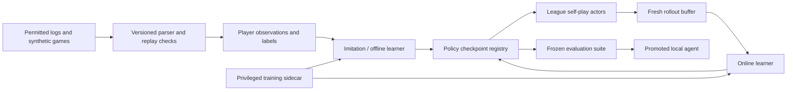

# Building a world-class Riichi Mahjong AI

Implementation and research blueprint · 16 October 2026

Prepared for an experienced programmer using an Apple M5 Pro MacBook Pro with 18 CPU cores, 20 GPU cores, and 64 GB unified memory, with Codex helping implement the system. This document is the research blueprint. Stages 0 and 1 have completed their documented gates; the [Stage 1 report](reports/stage1/REPORT.md) is ready for review before training. Training and strength claims require their own measured milestones.

**Revision notes — 16 October 2026:** incorporated the proposal review and measured hardware inventory. Keep average placement as the initial objective; add room-specific ladder diagnostics without treating historical ratings as a universal leaderboard. Audit simulator cloning and batching in Stage 0, bring match-value and privileged-critic experiments into the first learning cycle, enable four-seat collection after transition checks, and scale verification/evaluation progressively. Local execution remains the default; cloud compute is optional. Data-access work runs in parallel with a synthetic fallback.

The companion [implementation plan](docs/IMPLEMENTATION_PLAN.md) records stage deliverables and acceptance checks; the [decision log](docs/DECISIONS.md) records choices, evidence, and unresolved gates. Preserve this document's research rationale while using those shorter documents for implementation and progress reports.

## 1. The recommendation

Build a compact neural agent that uses only information available to its player, supported by a verified Riichi simulator. Establish a reproducible baseline, improve it through self-play against a varied opponent population, and add belief modeling and selective simulation only when controlled experiments justify them.

The practical sequence is:

**Local hardware and simulator audit → rules and evaluation → permitted data or synthetic demonstrations → imitation and value baselines → first self-play with reward/critic comparisons → league and four-seat scaling → belief-aware improvement → independent evaluation → efficient local deployment.** Offline RL is a controlled alternative, not a prerequisite for that sequence.

Your M5 Pro Mac is the development machine, primary trainer, and eventual playing machine. A model with a few million parameters is a sensible starting point. The difficult resource constraint is generating and learning from enough diverse, correctly simulated experience, not storing the final neural network. The measured core counts and 64 GB unified-memory capacity do not establish training throughput; the backend, simulator, batch sizes, and sustained behavior still need measurement.

I would start with **Python/PyTorch plus a Rust simulator**, use MPS acceleration where supported, and preserve a CUDA execution path for optional remote training. I would not start by writing a new simulator, training a language model, or building a large search engine.

World-leading strength is a research objective, not a result that can be promised from a particular architecture or budget. A strong, independently trained, reproducible agent is a realistic first target. A credible world-best claim requires access to the relevant opponents and a sufficiently large, controlled evaluation.

Unless otherwise identified as a sourced result, all sizes, hyperparameters, timelines, thresholds, and budgets below are proposed starting points. They must be revised using measurements from this project.

## 2. Define exactly what “best” means

Start with **four-player Riichi, East–South matches, red fives, a versioned Tenhou-compatible rules profile**. A match is a hanchan; an individual hand is a kyoku. A hanchan is not necessarily exactly eight hands because continuations, early termination, and extensions depend on the rules.

Keep three objectives distinct:

| Objective | Training target | Consequence |
|---|---|---|
| Best average placement | Maximize `2.5 - final_rank` | Simple initial research objective; treats each rank improvement equally |
| Best ladder performance | Maximize an explicitly specified rank-points vector | Can strongly favor avoiding fourth place |
| Best tournament score | Maximize final score plus the tournament's exact bonuses | Can justify different risks and late-game decisions |

For the first agent, use average placement as the primary objective and report the other outcomes. No deployment ladder has been selected, and Stage 0 performs no reward training. If a ladder later becomes the target, freeze its exact points table and compare a ladder-oriented checkpoint with the baseline. A table-conditioned policy is a later experiment; changing a utility input does not guarantee equally strong play under every table. Do not silently change the reward and compare resulting scores as though the task were unchanged.

Report a stable-dan diagnostic only when its room, match format, point schedule, and opponent population are stated. For the four-player Phoenix hanchan schedule with gains `+90, +45, 0` and fourth-place loss `-15 × (d + 2)`, solving for zero expected rank points gives `d = (6p1 + 3p2) / p4 - 2`, where `pr` is the observed probability of rank `r`. This ratio is not an individual game's reward or an achieved account rank; it can be unstable with few fourth places and is undefined when `p4=0`. Use an interval based on independent evaluation blocks. Other rooms require their own schedule and formula. This is an algebraic diagnostic derived from the [Tenhou points manual](https://tenhou.net/man/), not a room-independent skill rating.

Define success progressively:

1. **Correct:** complete full matches with no illegal actions, information leaks, or unresolved settlement errors.
2. **Competent:** consistently defeat random and reasonable heuristic agents.
3. **Strong:** beat a frozen imitation baseline and independently trained baselines on unseen seeds.
4. **Competitive:** beat accessible strong external checkpoints under identical rules and compute limits.
5. **World-leading evidence:** positive results against the strongest accessible systems, multiple opponent lineups, independent replication, and explicitly stated exclusions.

If LuckyJ, NAGA, MAKA, or another proprietary contender cannot participate, the honest conclusion is “strongest among the evaluated agents under these conditions.” Add LuckyJ to the comparison registry, but establish its evaluation conditions and actual access before setting a numerical target. Historical stable-dan reports from different rooms, periods, and opponent populations are not direct head-to-head evidence. A high imitation score or agreement with a reviewer cannot establish world leadership.

The October 2026 NAGA report illustrates the objective issue: its Ananta and Uroboros variants emphasize different finishing outcomes. Its stable-dan estimates are calibrated from internal comparisons, not directly interchangeable with live human-ladder achievements. [NAGA evaluation report](https://naga.dmv.nico/htmls/naga_new_types_league_report.html)

## 3. What we can actually reuse

| Resource | Verified access/status | Intended role |
|---|---|---|
| Mortal | Public Rust/Python source, AGPL-3.0-or-later | Reference baseline, possible fork, simulator and training implementation study |
| Mortal strong official weights | Maintainer's statement linked by current documentation says no public release planned | Do not make them a dependency; train our own or obtain an independently authorized checkpoint |
| MAKA | Mahjong Soul analysis feature; no official source/weights release verified | Product reference or separately arranged comparison |
| NAGA | Hosted service; no public training stack/weights verified | External comparison if authorized; its reports are not unrestricted distillation data |
| LuckyJ | Comparison target identified during review; runnable access and directly comparable evaluation not established | Track as a potential external contender; do not assume access to its weights or use its reported rating as a universal benchmark |
| Akochan | Public code/parameters with custom restrictive terms | Separate research opponent only within permitted use |
| Kanachan | Public annotation, simulation, and training framework; no supplied crawler, dataset, or trained models | Architectural reference; establish code licensing before reuse |
| RiichiEnv | Rust environment, Python interface, Apache-2.0, MJAI compatibility | Preferred initial independent environment candidate |
| Mjx | Public C++/Python research framework, MIT; pinned revision must pass the local build and rules audit | Independent transition/replay comparator or alternative engine |
| Mortal's libriichi | Rust core within the Mortal repository; applicable AGPL terms require review | Candidate differential-test engine, not an assumed license-free dependency |
| Mahjax | Apache-2.0 JAX environment with BC/PPO examples | Optional later remote-GPU throughput experiment |
| MahjongRepository/mahjong | MIT scoring/shanten library | Independent scoring cross-check, not the complete training environment |

Sources: [Mortal repository](https://github.com/Equim-chan/Mortal), [weights statement](https://gist.github.com/Equim-chan/cf3f01735d5d98f1e7be02e94b288c56), [MAKA launch](https://mahjongsoul.com/news/254), [NAGA current service terms](https://naga.dmv.nico/naga_report/top/), [Akochan license](https://github.com/critter-mj/akochan/blob/master/LICENSE), [Kanachan](https://github.com/Cryolite/kanachan), [RiichiEnv](https://github.com/smly/RiichiEnv), [Mahjax](https://github.com/nissymori/mahjax), [scoring library](https://github.com/MahjongRepository/mahjong).

The [Mjx repository](https://github.com/mjx-project/mjx) is an additional engineering reference. Audit each pinned dependency rather than relying on a README's feature list. Running another program in a separate process is an architecture choice, not by itself a conclusion about licensing obligations.

Two implementation tracks are useful, but we should choose one primary track rather than maintain two complete systems immediately:

- **Independent Mac-first track — recommended:** audit RiichiEnv first, then use the selected engine with our observation/action adapter, compact PyTorch policy, imitation and PPO training. This gives us direct control over MPS compatibility and experiment design; engine selection remains conditional on Stage 0 evidence.
- **Mortal reproduction track:** pin its source, respect AGPL obligations, adapt device-specific code, train our own weights, and reproduce its actual losses. This is attractive if reproducing an established implementation becomes the fastest validated path.

Mortal's inspected trainer uses chosen-action Monte Carlo value targets, an offline conservative penalty, and a rank-prediction auxiliary loss. It should not be described as an off-the-shelf PPO recipe. Its example configuration explicitly contains placeholder values. [Trainer](https://github.com/Equim-chan/Mortal/blob/main/mortal/train.py), [example configuration](https://github.com/Equim-chan/Mortal/blob/main/mortal/config.example.toml)

Check source, weight, dataset, and service permissions separately. A permissive wrapper does not change the license of the bot inside it. We can proceed with our own simulator-generated data while third-party data access is unresolved.

## 4. The first engineering milestone: trust the environment

Create a `RuleProfile` with a stable identifier and serialized hash. Explicitly record:

- Player count, tile set, red-five counts, starting scores, match length, end conditions, bust threshold, overtime, and dealer continuation.
- Open tanyao, minimum yaku requirements, riichi eligibility, riichi deposit timing, ippatsu cancellation, and post-riichi kan restrictions.
- Furiten, temporary furiten, riichi furiten, kuikae restrictions, all call priorities, simultaneous ron, and abortive draws.
- Dora/ura/kan-dora timing, rinshan, chankan, exhaustive draws, noten payments, nagashi mangan, honba, and remaining riichi sticks.
- Fu, han, caps, yakuman stacking, responsibility payments, final placement tie-breaking, and any platform-specific exceptions.

Select a preset as a starting point, then verify its behavior. RiichiEnv defaults to a single-hand mode, so the full-match configuration must be explicit. Its documented `4p-red-half` mode and Tenhou rule preset are a starting integration target, not a substitute for our conformance tests. [RiichiEnv usage and modes](https://github.com/smly/RiichiEnv/blob/main/README.md)

Before committing to an engine, audit cheap state cloning, explicit wall/state restoration, and batched continuation from arbitrary legal positions. Inspect the actual implementation and run small round-trip checks; distinguish a public supported API from an internal clone that omits RNG, pending calls, furiten, or other state. Record missing capabilities and their adaptation cost. This audit supports future search without requiring a search implementation in Stage 0.

Pin the RNG algorithm/version and wall-construction procedure in a separate reproducibility manifest. For cross-engine comparison, replay identical physical walls and action/event traces through adapters: the same integer seed does not make different engines consume randomness identically. Keep game-rule identity separate from RNG and implementation identity.

Build three kinds of checks:

1. **Deterministic fixtures:** rare scoring, furiten, kan, priority, and endgame examples with expected outcomes.
2. **Replay conformance:** legally obtained complete records replay to the same scores, legal options, reveals, and placements.
3. **Differential tests:** compare scoring and selected transitions against a separately implemented engine/library under the same rule profile.

Every physical tile must exist in exactly one location. Scores plus outstanding deposits must reconcile across transfers. The actor must not see concealed opponent tiles or future wall contents. Multiple implementations agreeing is useful evidence, but shared bugs remain possible; rare-rule fixtures need independent expected results.

Use progressive gates. Stage 0 needs deterministic smoke games, information-boundary checks, and a documented simulator capability audit. Before meaningful learning, require the dedicated rare-rule fixtures and an initial certified corpus of at least 1,000 complete synthetic or permitted recorded matches, with zero unexplained legal-action or settlement mismatches. Add independent scoring checks and transition comparisons wherever the adapter supports them. Grow to tens of thousands and then larger differential suites before expensive training or release; million-game campaigns are a later evidence target, not a prerequisite for the first learning smoke test.

Add property-based tests for tile conservation, point/deposit reconciliation, serialization and clone equivalence, and legal-action consistency. Keep cheap runtime invariants enabled during early self-play. Large random campaigns complement targeted rare-rule fixtures; neither zero observed mismatches nor agreement between engines proves correctness.

Save every failure as a minimal reproducible replay. Never “fix” a dataset by silently deleting all difficult examples.

## 5. System boundaries



The deployable agent should implement a small interface:

```text
initialize(rule_profile, seat, model_manifest)
observe(player_visible_event)
act(legal_action_candidates, deadline) -> one legal action
finish_match(result)
```

Keep the rule engine authoritative. The model chooses among legal candidates rather than inventing protocol messages. Protocol adapters, features, model inference, training, evaluation, and optional search should be separate modules.

The full simulator state belongs to the environment. A filtered player observation belongs to the actor. Privileged labels belong to a separate training interface. Do not pass a full state object to the policy and rely on programmer discipline to ignore fields.

MJAI is an interchange protocol/ecosystem, not a strong player by itself. Pin its dialect and test conversions. [Original MJAI server](https://github.com/gimite/mjai), [format specification](https://github.com/Cryolite/mjai)

## 6. Where the data comes from

| Source | Value | Access plan |
|---|---|---|
| Tenhou Houou/Phoenix records | Strong human decisions and complete-match outcomes | Obtain appropriate permission, then ingest a small pilot before scaling |
| Mahjong Soul high-level records | A different player population and room strengths | Use permitted exports or a research arrangement; no blanket public research API was verified |
| Existing converted corpora | Faster discovery and preprocessing experiments | Check upstream rights, provenance, completeness, and duplicates before use |
| Our heuristic agents | Immediate cheap demonstrations | Generate locally with known rules and exact provenance |
| Our trained agents and league | Unlimited evolving experience, all hidden-state labels available | Main long-term scaling source |
| Authorized third-party bots | Stronger demonstrations or opponents | Verify checkpoint and generated-output terms; record exact version |
| Consenting experts | Difficult-position judgments and external evaluation | Small targeted collections, independently held out |

Tenhou's current log page restricts uses, including competing products, and directs general Mahjong applications to contact the operator. Its download rules also prescribe compressed files, one session, and a minimum interval for automated index updates. These are not automatically unrestricted research data. [Official Tenhou log page](https://tenhou.net/sc/raw/)

The maintained `houou-logs` tooling is a useful acquisition reference after access is established. It warns about redistribution and reports unavailable historical ZIP endpoints. Therefore “download all years” is not a reliable acquisition assumption. [houou-logs](https://github.com/Apricot-S/houou-logs)

Concrete discovery candidates:

- [hhim8826/tenhou-houou-mjai](https://huggingface.co/datasets/hhim8826/tenhou-houou-mjai): the publisher reports 2,120,954 rows and about 6.29 GB of Parquet shards. Its card acknowledges 48,196 duplicate game pairs; removed original IDs and absent per-game timestamps complicate temporal splits. It grants no additional rights over upstream records.
- [nikketryhard/tenhou-houou-mjai](https://huggingface.co/datasets/nikketryhard/tenhou-houou-mjai): yearly/source archives and converted streams; audit actual coverage and source permissions. The tool's code license does not license the games.
- [MahjongLM dataset](https://huggingface.co/datasets/mitsutani/mahjonglm-dataset/blob/main/README.md): sequence-oriented records with multiple information views and source-data terms. Omniscient views cannot be used as legal actor inputs.
- [Kanachan data notes](https://github.com/Cryolite/kanachan/wiki/Notes-on-Training-Data): useful representation guidance; the main repository supplies no corpus. Historical private-collection counts are not downloadable dataset promises.

For Mahjong Soul, use the applicable regional terms and an explicitly permitted acquisition method. [Japanese service terms](https://dmg.mahjongsoul.com/terms_of_service)

**If we obtain no third-party data:** implement reasonable shanten/ukeire/defense heuristics, collect synthetic demonstrations, train a starter policy, and improve through self-play. This removes the external corpus dependency. It probably makes early learning less sample-efficient, so the experiment should measure that cost.

Record data access as a Stage 0 parallel decision track: identify the intended use and candidate permission routes while implementation proceeds on synthetic fixtures. Prepare a concrete inquiry if useful; sending it requires the user's authorization to contact the recipient. Do not block environment integration on a provider's response or assume access has been granted. If an authorized stronger teacher becomes available, compare its sample efficiency with the heuristic route.

Do not filter human data to only winners or winning hands. That creates outcome-selection bias and discards critical defense examples. Room/rank can inform sampling quality, but the actor should not receive player IDs or future results.

## 7. Data pipeline and schema

Maintain four layers:

1. **Raw:** immutable original bytes, SHA-256, origin, acquisition conditions, and timestamps where permitted.
2. **Canonical:** versioned event streams, semantic game hash, exact rules, and source-field sidecars.
3. **Player views:** observations constructed with the same encoder used during live play.
4. **Training records:** decisions, targets, masks, transition links, and provenance.

```text
game_id, source_id, source_timestamp, raw_sha256, semantic_hash
rule_profile_id, converter_version, schema_version, split
hand_id, event_index, player_seat, player_observation
legal_candidates, chosen_candidate, action_identifiable
next_decision_for_same_player, terminated, truncated
terminal_rank, final_scores, optional_auxiliary_targets, validity_masks
policy_versions, behavior_log_probability_if_known, reward_version
```

Store full hidden states and RNG seeds separately. Human records do not normally contain behavior probabilities; a fitted imitation model does not turn estimated probabilities into ground-truth propensities.

Replay each accepted game. Verify legal moves, tile identities, meld consumption, scores, reveals, and final rank. Record failures and missing fields. Retain rejection/filter counts by source, year, rules, and identifiable action category to expose selection bias. Some formats reveal hidden hands or seeds after the game; availability at the end is not availability at the decision.

Important label cases:

- An unrecorded call does not always mean “pass”: a higher-priority response may have preempted it. Mark ambiguous choices as censored, excluding unknown actions from both imitation and offline-RL chosen-action/TD losses. Valid auxiliary targets may still be used.
- A protocol acknowledgment with no choice is not a strategic pass. Track forced actions separately.
- Riichi declaration and the associated discard must have a consistent compound or sequential representation.
- Red and ordinary fives, alternative chi consumptions, all kan forms, and meaningful drawn-tile versus hand-discard distinctions must round-trip correctly.
- The next transition is the next decision of the same player, with intervening rewards/events accounted for, not simply the next global event.
- An observed outcome labels the action taken. It does not reveal the value of every alternative.

Split by whole match before producing player views, crops, augmentations, or teacher labels. Deduplicate using original IDs and semantic equivalence, not only raw text hashes. Different converters can encode the same game with different serialization and reveal timing; preserve strategically meaningful timing.

Preferred split: chronological train/development/test, such as through 2023 / 2024 / 2025, if accessible coverage supports it. Keep a later prospective set. If timestamps are missing, use a documented grouped hash split and do not call it chronological. A player-disjoint test is useful only if appropriate identifiers exist and can be used.

Augment only with verified rule-preserving transformations. Arbitrary suit swaps are not exact symmetries because all-green distinguishes souzu and green dragon; winds and dora successor relationships also carry meaning. Transform histories, indicators, red flags, actions, scores/seat metadata, and targets consistently, then check legality/scoring invariance. Never multiply a corpus with unverified transformations.

## 8. Information security is also experimental validity

For player `i`, the policy is `π(a | I_i)`, where `I_i` contains only their legal information at that point.

Allowed features include own hand, drawn tile, public discards/calls, public riichi/dora information, scores, dealer, round/seat winds, honba, deposits, remaining-tile count, and legal actions derived from that information.

Forbidden actor features include concealed opponent hands, future wall order, RNG seed, unrevealed ura-dora, future actions, final rank, future scores, or labels backfilled from later reveals. A feature such as “this tile is safe because no opponent can ron it” is illegal if calculated from concealed hands.

Use an **information-set invariance test**: construct two legal underlying worlds that have exactly the same information for the actor. Its encoded observation, legal-action representation, and deterministic logits must match. Also test recurrent-state initialization and reset behavior.

Keep every seat's recurrent memory separate even when they share network weights. Opponent policies in simulated rollouts get only their own legal observations. Evaluators must not expose the reproducible wall seed through the agent interface.

Training-only hidden-state targets are useful: the model may learn to predict unseen information from visible evidence. This is fundamentally different from feeding the answers into it.

## 9. Models to build first

Use structured tensors and compact event tokens. A general-purpose language model adds substantial compute without an established advantage for this task.

### Model A: economical baseline

- Tile feature planes over 34 tile types, with explicit red-five state.
- Public per-player features and own-hand counts, plus scalar score/round features.
- A compact residual convolutional encoder, initially around 2–5 million parameters, measured after implementation.
- Explicitly respect suit boundaries; convolution across adjacent array indices must not invent a sequence between suits.
- Policy head over legal candidates and a public-information value head.
- Optional auxiliary rank-distribution head.

Use exact shanten, legal waits, and visible-tile-based ukeire as optional features. These derive from permitted information and can reduce the amount of discovery required. Ablate them later; removing useful features is not a prerequisite for “proper AI.”

### Model B: event-history challenger

- Four to six Transformer blocks, width 256, initially four attention heads and feed-forward width 1,024.
- Hand/tile embeddings, relative player identifiers, event kind, red flag, tsumogiri/reach/call information, and time position.
- Separate scalar context encoder.
- Start with 256–512 event tokens per example and explicitly handle longer histories; no silent truncation.
- Encode only the available prefix. Bidirectional attention inside a legal prefix is acceptable; attention into future log events is not.
- Preserve a complete public-state summary even if older history is summarized or cropped.

Treat roughly 5–15 million parameters as a design budget, not a guaranteed count or strength target. Compare against Model A at both equal training compute and equal inference budget.

### Action representation

Enumerate all legal candidates with descriptors: action type, tile, consumed tiles, red flags, source seat, and any relevant discard/riichi metadata. Score each candidate with the policy. A fixed action head is also acceptable if its mapping covers all required distinctions and is exhaustively tested.

Do not learn legality. Do not assume choosing a discard covers calls, riichi, kan, passing, ron, tsumo, and abortive draws. Legal win-declining decisions should remain representable where the rules allow them.

### Useful auxiliary heads

Predict final-rank distribution, opponents' tenpai probability, tile danger, and expected loss conditional on a deal-in. Synthetic full-state data supplies exact labels for some of these, but all predictions must come from legal actor inputs.

Keep these definitions separate: “opponent is in tenpai,” “tile completes a yaku-valid hand,” “ron is legal given furiten,” and “opponent will actually choose ron” are different targets. Mask unavailable or ambiguous labels. Evaluate calibration as well as accuracy.

Introduce inexpensive supervised auxiliary heads during the first learning cycle, after their labels and information boundaries pass tests. They do not need to wait for a large policy or search implementation. Marginal predictions are useful features and diagnostics; they are not by themselves a joint posterior over hidden hands and wall states.

## 10. Stage A — baseline and behavior cloning

Create four reproducible opponents: random legal, shanten/ukeire heuristic, a conservative defense variant, and a frozen first neural checkpoint. These expose obvious learning failures and provide an initial league without external weight access.

Start with 5,000–10,000 complete permitted or generated matches for pipeline validation. Then use approximately 100,000 games for the first serious imitation comparison, increasing toward 300,000 or more only if throughput and learning curves justify it.

For a demonstrated action `a*` among legal candidates `A(I)`:

```text
L_BC = -log πθ(a* | I)
```

Initial configuration:

| Parameter | Starting choice |
|---|---|
| Optimizer | AdamW |
| Learning rate | `3e-4`; compare `1e-4` if unstable |
| Weight decay | `1e-4` |
| Effective batch | 256–1,024 decisions; microbatch according to measured memory |
| Gradient clipping | Global norm 1.0 |
| Precision | FP32 first; lower precision only after parity checks |
| Epochs | 1–3 initial passes; select by development performance |
| Seeds | One for debugging, three for serious comparisons |

Sample by decision type enough to avoid drowning rare actions in discards, but preserve or correct for the intended training distribution. Report both natural-frequency and balanced metrics. Exclude ambiguous action labels from imitation loss; they may still support other valid targets.

Overfit a tiny fixed batch first. Then measure per-action negative log likelihood, top-k accuracy, calibration, legality, and actual match performance. Train on whole realistic trajectories and maintain separate forced-choice statistics so apparent accuracy is not inflated.

Promotion requires improvement against the heuristic panel on unseen seeds. Human imitation accuracy alone is not a strength gate.

Before sparse-reward PPO, explicitly train the value/rank head on complete-match outcomes. BC action loss alone does not initialize a useful critic. For the selected utility, regress observed terminal returns or predict final-rank probabilities and derive expected utility. Use held-out calibration tests; these targets initially reflect the demonstration/behavior policy, so refresh the critic as the acting policy and opponent mix change.

Prepare a small global-rank/match-value predictor in this same cycle, using complete-match labels and hand-boundary public context. Its first uses are calibration, a reward-design comparison, and evaluation diagnostics. A privileged history-and-state critic is also an early controlled comparison once the public critic works; neither requires a mature league. Stage 0 establishes interfaces and synthetic smoke tests only and does not train these models.

## 11. Stage B — optional offline reinforcement learning

Offline RL can extract more value from a fixed corpus, but it is not mandatory before useful self-play. On the laptop, I would first establish BC→PPO as the simplest end-to-end learning system, then compare an offline stage when authorized data are available.

Two candidate experiments are conservative Q-learning-style regularization and implicit Q-learning. CQL addresses overoptimistic values for poorly supported actions; IQL uses value expectiles and advantage-weighted imitation without explicitly optimizing over unseen dataset actions during its value-learning step. Neither paper guarantees performance in our nonstationary multiplayer setting. [CQL](https://arxiv.org/abs/2006.04779), [IQL](https://arxiv.org/abs/2110.06169)

For a small discrete CQL experiment, the conservative penalty has the form:

```text
α × [logsumexp over legal a of Q(I,a) - Q(I,a_observed)]
```

Combine it with a deliberately specified return or Bellman target. For a Mortal reproduction, use its actual target construction instead of substituting a generic algorithm with the same name. For a new bootstrapped implementation, version target networks, terminal handling, and legal masks.

Compare BC, BC+offline RL, and BC+self-play using the same total compute budget. Inspect Q-value calibration and out-of-distribution actions. Historical human opponents are part of the dataset's dynamics, so an offline improvement must still survive live simulation against the intended opponent pool.

Do not use unreliable offline policy evaluation as the sole promotion gate. The simulator gives us a direct evaluation route.

## 12. Stage C — full-match self-play

Use PPO as the initial independent implementation because its updates and diagnostics are relatively straightforward. This is an engineering starting hypothesis; we will compare it with the established baseline if it plateaus. [PPO paper](https://arxiv.org/abs/1707.06347)

At the start, train one designated learning seat against three frozen opponents, rotating seats across games. Collect only actions taken by the behavior policy being optimized. Once per-seat transitions, terminal rewards, legal masks, and old log probabilities pass correctness checks, compare collecting all four seats when all four use the frozen learner behavior snapshot. Keep observations, memory, values, and rewards separate by seat. Multiple seats can supply more usable decisions per match, but these samples are correlated; this is not a guarantee of fourfold independent information or wall-clock speed. Mixed lineups still contribute PPO actions only from seats using the eligible learner behavior policy. Do not apply on-policy PPO to old opponent actions simply because they appear in the replay.

```text
repeat:
    snapshot learner policy and league sampling distribution
    generate full-match rollouts or correctly bootstrapped segments
    record player observations, legal masks, selected actions,
           old log probabilities, values, policy versions, outcomes
    construct per-player advantages and returns
    take a small number of PPO minibatch epochs
    discard stale on-policy rollouts
    periodically evaluate a frozen candidate on development seeds
    promote only after the predefined comparison passes
```

Use persistent environment states across rollout boundaries. A training batch ending is not a terminal match. At true match termination, bootstrap value is zero; at an administrative cutoff, bootstrap correctly and flag truncation. Never convert an unfinished hanchan into a draw or a fabricated final placement.

Test the case where an opponent ends the match after the learner's last action: terminal reward still belongs on the learner's final transition. Compare GAE near one and complete-match Monte Carlo targets if the initial critic cannot propagate the sparse outcome effectively.

For a collected action, let `ρ = exp(log π_new(a|I) - log π_old(a|I))`. Maximize the PPO term `min(ρ × advantage, clip(ρ, 1-ε, 1+ε) × advantage)`, add an entropy bonus, and minimize the critic's return-prediction loss. Use the identical legal mask when computing old/new probabilities. Compute GAE on each player's decision timeline; with `γ=1`, intervals between decisions do not introduce an unintended preference for faster hands. Start with a feed-forward encoder over legal history prefixes so recurrent batching is not an additional source of bugs.

Single-legal-action decisions need no policy or entropy loss, but they may still carry value targets and intervening rewards. Retain their transition semantics, or merge them with a tested reward/discount transformation. Do not remove them from a trajectory merely to improve a decision-throughput number. Batch simulator-to-model calls first; move additional loops into Rust only where profiling shows the benefit.

Initial local settings:

| Parameter | Pilot range |
|---|---|
| Active environments | 32–128 initially; increase only when batching helps |
| Simulator workers | Start at 4; benchmark 2/4/8 against available CPU resources |
| Learner decisions/update | 8,192–32,768 initially |
| PPO epochs | 2–4 |
| Minibatch | 256–1,024, memory permitting |
| Policy learning rate | `1e-4`, with `3e-4` as an ablation |
| Clip ratio | 0.1–0.2 |
| GAE lambda | 0.95–0.99; compare return estimates for long matches |
| Discount | `γ = 1` for the finite-hanchan placement objective |
| Entropy coefficient | Start around 0.01; tune with action-count-aware diagnostics |
| Value coefficient | 0.5 initially, adjusted to target scale |
| Global gradient norm | 1.0 |

These values are not independently optimal. Keep the first sweep small: learning rate, rollout size, and update epochs before architecture proliferation.

Log approximate KL, clipping fraction, entropy by decision type, explained variance, return scale, actor-version lag, invalid actions, throughput, and opponent composition. Preserve optimizer and RNG states for resume. If asynchronous actors become necessary, bound lag or use a deliberately off-policy method; do not assume stale PPO data is harmless.

## 13. Reward design across a full match

For the initial task, give terminal reward:

```text
first: +1.5    second: +0.5    third: -0.5    fourth: -1.5
```

This directly optimizes average placement. For a ladder agent, replace it with a specified, normalized ladder utility. For a tournament agent, use the tournament score. Store the objective in every checkpoint manifest.

Avoid permanent arbitrary bonuses for reducing shanten, declaring riichi, winning any hand, or avoiding every deal-in. Such rewards can teach the wrong tradeoffs. A low deal-in rate is a diagnostic, not proof of strong play.

Use terminal rewards plus a trained value baseline as the reference. Compare it with a fixed/versioned potential model in the first reward experiment, rather than postponing all dense feedback until a long sparse-reward run has failed:

```text
r'_t = r_t + γ Φ(I_{t+1}) - Φ(I_t)
```

Set terminal potential to zero and use a fixed/versioned potential across each collected trajectory. With `γ=1`, complete-trajectory shaping telescopes to an initial-state term, preserving the intended total-return preference when implemented correctly. Bootstrap consistently at rollout cuts. This does not establish convergence of the whole multiplayer learning procedure. [Potential-based shaping](https://ai.stanford.edu/~ang/papers/shaping-icml99.pdf)

A separate match-value model can predict eventual placement from scores, dealer, round, honba, deposits, and relevant public history. This is a useful direction inspired by Suphx's global reward prediction. Suphx also investigated oracle guidance and run-time adaptation; its historical results establish strong precedent for deep RL, not a reproducible current champion recipe. [Suphx paper](https://arxiv.org/abs/2003.13590)

Keep two constructions distinct. Potential shaping adds the differences above to terminal reward and sets terminal potential to zero. A hand-boundary reward decomposition can instead use consecutive predicted match values and replace the final boundary value with actual terminal utility. Its undiscounted differences telescope over the complete match when the same predictor version is used consistently. Do not add the final utility again and double-count it.

Telescoping scalar rewards does **not** prove that independently optimized hand episodes have the same policy gradient as full-match training. Truncating returns at a hand boundary replaces later consequences with a continuation estimate. That estimate can be stale, approximate, or conditioned on insufficient history; opponent and learner policy changes matter. Start with complete-match or correctly bootstrapped trajectories. Treat independently reset hand episodes as an ablation with explicit continuation targets, not as an unbiased shortcut. Preserve naturally occurring hand-start distributions for the reference run; deliberately oversampled late-match situations are a curriculum requiring separate reporting.

## 14. The opponent league

Pure play against copies of the latest model can cycle or discover narrow conventions. Use a small, persistent population.

An initial sampling proposal for opponent lineups:

- 40% recent stable snapshots.
- 30% historical snapshots, sampled across several generations.
- 20% frozen reference agents, including heuristics and permitted external opponents.
- 10% held-in training exploiters or unusual strategy variants.

These percentages are a starting allocation. Make them configurable and log the actual sampled lineups. Keep opponent checkpoints fixed within a game. Do not share private information, hidden memory, or a communication channel between seats.

Start with 8–16 retained snapshots and a small cross-play matrix. Keep strategically distinct older policies rather than only the latest eight files. Train a response agent against the current champion periodically; if it reveals a weakness, add it to the training pool and reevaluate broader performance.

Retained snapshots need not all reside in accelerator memory. Group inference queues by checkpoint, cap resident models, and benchmark the actual heterogeneous opponent mixture. A many-model league can fragment batches and erase the throughput measured with four copies of one policy.

Maintain a separate opponent holdout. A newly discovered test opponent used for training becomes a development opponent; it no longer counts as untouched evidence.

The target is robustness to varied players. Do not claim Nash equilibrium, exact exploitability, or an unbeatable strategy from league results in four-player Mahjong.

## 15. Research experiments, staged by prerequisites

### A. Better uncertainty and defense modeling

Use synthetic hidden-state labels to train opponent tenpai, waits, and deal-in cost predictions early, alongside the first value experiments. Evaluate them on both league and held-out opponents. Compare neural calibration with simple baselines; better prediction does not necessarily improve decision utility.

An explicit hidden-state sampler must generate **jointly legal** concealed hands and walls consistent with all visible tiles and events. Independently sampling each player's tile marginals can produce impossible worlds. Begin with uniform constrained allocation as a baseline, then condition on action history. Record sampler calibration and rejection rates.

Uniform hard-constrained allocation is not an exact posterior over opponents' hands: observed decisions carry information about those hands and the policies that produced them. Under a fair shuffle, unobserved future wall positions may be sampled uniformly **conditional on a correct joint allocation and the relevant observed/history constraints**, with dead-wall and known positions handled correctly. This conditional fact does not make an approximate hand sampler exact. A learned joint sampler may require autoregressive allocation and reconstruction of private histories/furiten state; validate its consistency and recalibrate when the opponent mixture changes. [Learned Belief Search](https://arxiv.org/abs/2106.09086)

### B. Training with privileged information

Compare a public-information critic with a separate privileged **history-and-state** critic during the first self-play experiments. The actor and its deployment encoder remain observation-only. Keep separate input paths and check gradient/data boundaries. A detached, action-independent pre-action baseline cancels in the ordinary Monte Carlo policy-gradient expectation, but this fact does not make an approximate, bootstrapped, clipped PPO update unbiased. A state-only critic can omit policy-relevant history in a partially observed problem, and additional information does not guarantee lower variance. Compare return error, advantage variance, stability, wall-clock cost, and complete-match strength. [Unbiased asymmetric actor–critic](https://arxiv.org/abs/2105.11674), [Asymmetric actor–critic analysis](https://arxiv.org/abs/2201.01221)

Oracle-teacher distillation is another experiment: an informed teacher can guide a student, but its decisions may depend on facts the student cannot infer. Train and evaluate the student under legal information, and avoid claiming oracle strength transfers automatically. [Variational Oracle Guiding](https://openreview.net/forum?id=pjqqxepwoMy)

### C. Selective belief-conditioned rollouts

Add search after simulator cloning, belief sampling, and policy/value baselines work. First test a cheap one-step value-ranking experiment before engineering a large tree. Initially investigate high-impact decisions: pushing against riichi, declaring riichi, a consequential call/kan, or late-match placement thresholds.

Proposed first experiment:

1. Retain the top 2–4 policy actions plus tactically relevant legal alternatives.
2. Sample 16–64 consistent hidden worlds.
3. For each candidate, simulate observation-limited continuation policies, reusing initial worlds for paired variance reduction.
4. Evaluate terminal utility or a calibrated leaf value for the root player under the same objective, including immediate rewards and all relevant reaction/chance branches.
5. Measure whether the extra compute improves complete-match outcomes within the deadline.

The relevant estimate is an average of candidate values across consistent worlds. Do not let the real actor choose a different root action after seeing each sampled hidden world and then average those perfect-information best cases. That creates strategy fusion and optimism.

Each simulated player acts on its own information. The real player's rollout policy must not access hidden hands merely because the simulator contains them. Belief approximations and finite-depth values can still be biased; this procedure is an experiment, not guaranteed safe improvement.

A privileged leaf critic can estimate the return of a fixed, observation-limited continuation policy in each sampled world. This does not itself require a clairvoyant continuation policy. Average candidate values across worlds before selecting the root action. Do not maximize future choices using inaccessible information, or negate the next player's value as if this were a two-player zero-sum game. Audit the critic's training policy, seat perspective, depth, and distribution shift.

An optional conservative comparison is a policy-regularized action distribution `q(a) ∝ π(a|I) × exp(Q(a)/λ)`, corresponding to maximizing expected estimated value minus `λ × KL(q || π)`. Tune the temperature on development opponents and keep a legal-policy fallback. The piKL work provides a useful reference for regularizing search toward a prior; its setting and empirical results do not establish safe improvement for four-player Riichi. [piKL paper](https://arxiv.org/abs/2112.07544)

A low-confidence or time-limited search falls back to the validated policy. Extra search should improve measured utility per millisecond. ReBeL is useful intellectual context, but its equilibrium result is for two-player zero-sum games and cannot simply be transferred to four-player Riichi. [ReBeL](https://arxiv.org/abs/2007.13544)

### D. Distill expensive improvements into a local model

If a larger model or search policy is stronger, generate authorized teacher trajectories and train a compact student. The teacher may run locally; remote compute is optional. Use action distributions and value targets where available, then fine-tune with self-play. Reevaluate the student independently: distillation and quantization can change strategic strength.

## 16. Your 64 GB MacBook Pro: concrete execution plan

The measured machine is an Apple M5 Pro MacBook Pro with 18 CPU cores, 20 GPU cores, and 64 GB unified memory. Use native PyTorch with MPS as the initial local training path, with CPU as the correctness reference and a candidate for small inference batches. Record the exact macOS, Python, PyTorch, compiler, and simulator versions in the Stage 0 inventory. Hardware specifications do not establish throughput: backend/operator coverage and sustained performance must be measured for our actual model. [Apple PyTorch guide](https://developer.apple.com/metal/pytorch/)

Use native macOS for local training. Keep a portable CPU/CUDA path for Linux. Do not make a Linux Docker container the assumed route to Apple GPU acceleration. Audit imported code for unconditional `torch.cuda` operations, CUDA autocast/scalers, device-specific synchronization, and compilation assumptions. Mortal's online client contains CUDA-specific calls, so changing one device string is not sufficient evidence of portability. [Mortal client source](https://github.com/Equim-chan/Mortal/blob/main/mortal/client.py)

MPS does not support float64 tensors. Mortal's global-rank predictor and training reward path use double precision, so a reproduction also needs a precision audit. Keep necessary double-precision preprocessing on CPU, or implement normalized FP32 equivalents and verify their outputs and training behavior before using MPS. Do not silently cast everything and assume parity. [MPS limitations](https://docs.pytorch.org/docs/main/notes/mps.html), [Mortal model](https://github.com/Equim-chan/Mortal/blob/main/mortal/model.py), [Mortal trainer](https://github.com/Equim-chan/Mortal/blob/main/mortal/train.py)

JAX-on-Metal is documented as experimental. I would therefore keep Mahjax out of the critical local path until an exact compatibility test passes. [JAX installation support](https://docs.jax.dev/en/latest/installation.html), [Apple JAX guide](https://developer.apple.com/metal/jax/)

MLX is a credible alternative Apple-oriented training framework, with autodifferentiation and shared-memory execution; its current repository also documents Linux backends. I would benchmark a small equivalent model only if MPS is a measured bottleneck. Starting with PyTorch makes reuse of the inspected Mahjong implementations and model comparisons simpler. A framework rewrite needs measured gains that outweigh the added implementation and parity work. [MLX repository](https://github.com/ml-explore/mlx)

Local configuration:

- Start with Model A and FP32; test CPU/MPS forward values, masks, losses, gradients, and several optimizer steps on the same fixture batch within numerical tolerances.
- Benchmark single-decision CPU inference as well as batched MPS inference. GPU dispatch can dominate tiny requests.
- Use a central inference batcher for simulator workers; avoid each worker loading its own GPU model and competing for memory.
- Start with a few workers and bounded queues. Keep data parsing and feature generation in CPU processes or Rust, and avoid Python event-by-event overhead in the hot loop.
- Stream compact records. Use integer/categorical representations and materialize dense floats per batch.
- Aim initially for total application usage around 32–40 GB, leaving room for the OS, editor, caches, and bursts. Measure real peak memory rather than treating 64 GB as dedicated accelerator memory.
- Run sustained 20–30 minute benchmarks on power; distinguish warm-up, compilation, steady-state throughput, and thermal slowdown.
- Checkpoint periodically and on graceful interruption. Training should resume after sleep/restart without losing the run's identity.

The current project folder is under iCloud Drive. Keep source and reports there if desired, but put active datasets, replay buffers, temporary shards, and frequent checkpoints in a configurable non-synced local data directory or fast external SSD. Choose and authorize that path during implementation; do not let sync traffic dictate training performance.

A capacity illustration: 100,000 games × 400 retained decisions/game × 2 KB/materialized sample is approximately 80 GB. These are assumptions to replace with pilot measurements. Raw compressed logs can be far smaller; decoded tensors and duplicate histories can be much larger.

## 17. Measure training cost instead of guessing it

Benchmark these separately:

1. Simulator events per second with a trivial policy.
2. Full hanchans per hour with our actual policy.
3. Learner-seat decisions generated per second.
4. Supervised decision-examples processed per second.
5. End-to-end RL throughput including inference, data transfer, and optimization.
6. Decision latency at deployment: median, p95, p99, and timeout rate.

Publish units. “One million steps” might mean environment events, one seat's decisions, all four seats' decisions, or repeated optimizer examples. They are not interchangeable.

For `N` distinct training decisions, `E` epochs, and measured supervised rate `q`:

```text
supervised_seconds ≈ N × E / q
```

For `N` rollout decisions and measured end-to-end RL throughput `q_RL`:

```text
RL_seconds ≈ N / q_RL
```

Illustration only: 100 million rollout decisions at 1,000/s takes about 27.8 hours; at 100/s it takes about 11.6 days. These are arithmetic scenarios, not Mac performance estimates. Add evaluation, failed runs, preprocessing, and multiple seeds.

An initial sample ladder:

| Run | Proposed scope | Purpose |
|---|---|---|
| Stage 0 smoke | Small deterministic synthetic engine/inference fixtures; no reward training | Establish local execution and expose integration failures |
| Learning smoke | 100–1,000 matches; tiny learning batch, after correctness gates | Detect learning-loop failures |
| Local learning pilot | 1–10 million distinct decisions | Establish that learning improves play |
| Serious local run | 10–100 million decisions if measured time is acceptable | Compare one or two strong configurations |
| Optional remote extension | 100 million–1 billion decisions, incrementally, only if chosen | Test a scaling hypothesis after local evidence |

These are experiment allocations, not estimates of the amount required for world-class strength. Stop or change direction when confidence intervals and learning curves show that another tenfold run is a poor use of compute.

Published reference points are hardware-specific: Mortal documents up to 40,000 hanchans/hour on an RTX 4090 plus Ryzen 9 7950X at large batch size. This does not predict our laptop training throughput. [Mortal benchmark note](https://mortal.ekyu.moe/)

For historical scale, Suphx's controlled RL experiments reported 1.5 million games per variant over two days, using four Titan XP learner GPUs and forty K80 worker GPUs. Hardware and algorithms have changed, but this is a useful warning against promising frontier strength from a short laptop run. Its expensive initial-hand adaptation experiment is also not a suitable default local inference strategy. [Suphx experimental setup](https://arxiv.org/html/2003.13590v2)

Mahjax reports about one million red-rule simulator steps/second on eight A100s using a random policy. Its reported learning experiment used a simplified no-red single-hand task, heuristic imitation initialization, and fixed baseline opponents. The paper is evidence of promising simulation throughput, not full-match world-class training. [Mahjax paper](https://arxiv.org/html/2605.20577v1)

## 18. Other training routes

**Route 1 — entirely local:** the default project path, from development through compact-model training, comparative experiments, and deployment. Run larger batches overnight only after profiling. Cap each experiment by both decisions and wall-clock time. Optimize sample efficiency and evaluation allocation before increasing scale. World-leading strength remains unproven until evaluated.

**Route 2 — Mac plus a rented GPU burst:** an optional route if the user later chooses it for a measured bottleneck or scaling hypothesis. It is not a project prerequisite or the automatic response to slow training. Use one Linux NVIDIA GPU with enough memory for the measured workload, adequate CPU cores for simulation, and fast local storage. Run a small identical benchmark first. A GPU rental with insufficient CPU or storage can be slower overall than expected.

Package pinned source, lockfiles, rule/feature schemas, model configuration, a small permitted fixture set, and a resume checkpoint. Validate CPU/MPS/CUDA agreement within tolerances. Compare cost per million useful learner decisions and per completed evaluation match, not advertised GPU specifications.

Budget by measured GPU-hours. For example, 500 hours at a hypothetical $1/hour is $500; at $3/hour it is $1,500, before CPU, storage, transfer, and tax. These are illustrative prices, not provider quotes. Obtain current quotes when a concrete run exists; set a spend cap, checkpoint interval, and shutdown condition before launching paid work.

**Route 3 — academic compute:** if this belongs to a university or research institution, request an allocation with a reproducible baseline, learning curve, and expected decision budget. This is often more defensible than requesting hardware for an unspecified “best AI.” Access and grant availability must be checked at that time.

**Route 4 — trained checkpoint transfer:** if a strong checkpoint is legitimately available, fine-tune it and document provenance. This can reduce startup cost but changes what “trained from scratch” means. Maintain a scratch-trained baseline if that distinction matters academically.

**Route 5 — remote teacher, local student:** train or search expensively elsewhere, distill to a compact policy, and run the final agent on the Mac. The machine that serves the model does not need to be the machine that trained it.

Do not buy a cluster before a one-machine pilot identifies the bottleneck. Multi-GPU training is a later option, with distributed complexity justified only by measured scaling.

## 19. Evaluation that can support a strength claim

Use separate development tournaments and a locked final test. Freeze rule profile, reward, opponents, model hashes, seeds, compute limits, and statistical analysis before the final run.

Evaluate several table configurations:

- One candidate against three copies of a fixed baseline, with candidate seat balanced.
- One candidate against mixed strong opponents.
- Tables with multiple candidate copies to expose population-sensitive behavior.
- A league spanning several independently developed policies.
- Held-out human-style or unusual agents to probe distribution shift.

An agent playing only against copies of itself averages rank 2.5 by symmetry; that result cannot show improvement. Likewise, an increase in return against a weakening training pool is not evidence of stronger play.

Use matched random seeds and seat rotations to reduce variance. Predefine a reproducible stream of random walls for repeated hands and overtime. Calls change who draws what and how long games last, so common seeds reduce variance without guaranteeing identical trajectories.

If comparing candidate A and candidate B, insert each separately into the same evaluation seat/opponent configuration on paired seed blocks. Do not pretend four correlated seats or rotations are independent games. Bootstrap or analyze at the independent seed-block level. Use separate inference randomness streams where necessary and record them.

Primary reports:

| Measure | Interpretation |
|---|---|
| Average rank and confidence interval | Primary placement objective |
| Mean specified utility | Initially `2.5 - rank`; a separately declared ladder/tournament target only in future experiments |
| First/second/third/fourth rates | Risk distribution hidden by one scalar |
| Room-specific stable-dan estimate, if applicable | Derived diagnostic with uncertainty and named opponent population; not actual achieved rank |
| Score change, win/deal-in rates, hand values | Diagnostic behavior, not independent proof of strength |
| Per-opponent and per-seat results | Reveals narrow wins and seat bias |
| Latency, timeouts, illegal actions | Operational fairness and reliability |
| Across-training-seed variability | Distinguishes a stable algorithm from a lucky checkpoint |

A sample-size illustration explains why hundreds of games are inadequate for tiny improvements. If rank variance is approximately 1.25, a single agent's 95% mean-rank interval has half-width roughly `1.96 × sqrt(1.25/N)`. Reaching ±0.01 requires about 48,000 independent games. This is a precision calculation, not the power of a two-agent comparison. Two independent equally sized samples need roughly twice as many per arm for that difference precision; paired designs use the measured variance of paired differences.

For a two-sided 5% test with 80% power, a paired approximation is:

```text
independent_seed_blocks ≈ (1.96 + 0.84)^2 × variance(paired_difference) / effect_size^2
```

Estimate that variance in a pilot. Do not assume seat rotation gives a particular variance reduction. Broad gates might use 1,000 games for smoke testing, 5,000–20,000 for screening substantial gains, and 50,000–200,000 or more for close final comparisons, adjusted by power analysis. These are examples of different stages, not a requirement to run a huge tournament for every checkpoint.

Reserve fresh seeds for confirmatory testing. Repeatedly checking ordinary confidence intervals and stopping when one turns positive inflates false discoveries. Use a predefined sample size or a valid sequential method. Across many experiments, distinguish exploratory findings from preregistered confirmations. Report confidence intervals and multiple training seeds; general RL evaluation literature documents how unstable point-estimate comparisons can be. [Statistical evaluation paper](https://arxiv.org/abs/2108.13264)

### Staged evaluation and variance reduction

Use cheap deterministic regressions first, short development matches second, and frozen full-match tournaments for promotion. Hand-value predictions and hand-level outcomes can screen gross failures and explain behavior; they are proxies for the selected match objective and cannot certify a placement improvement. Allocate most evaluation to a small number of credible finalists.

After the raw evaluator is correct, investigate an AIVAT-style control-variate estimator. Begin with toy games whose exact expected values are known, then pilot on Mahjong while reporting both raw and adjusted estimates. Correct conditional expectations and known action/chance probabilities are essential; a fitted opponent model is not equivalent to a known behavior policy. Freeze or appropriately cross-fit learned value corrections, account for shared seed blocks, and check estimator bias and interval coverage. A deterministic agent has no action-sampling variance to remove at its forced policy choice. Do not import poker's reported variance-reduction factor as a Mahjong performance estimate. [AIVAT](https://arxiv.org/abs/1612.06915)

Use a sequential promotion procedure only after its assumptions match our bounded utility, paired blocks, opponent sampling, and variance estimator. A standard chess win/draw/loss SPRT is not directly a four-player placement test. Prespecify maximum games, decision thresholds, and an inconclusive outcome; confirm the analysis on synthetic null and known-effect fixtures before relying on early stopping.

### Promotion rule

For a frozen candidate, require: correctness suite passes; deployment budget met; primary utility improves with the predefined statistical criterion; no prespecified unacceptable regression on the mixed-opponent panel; and the result repeats across serious training runs. Keep the prior champion if evidence is inconclusive.

For public bot play, use a platform or event that explicitly accepts bots. RiichiLab advertises an open bot arena and an MJAI/WebSocket interface; it is a potential external validation venue, not a universal world ranking. [RiichiLab](https://riichi.dev/docs)

## 20. Experiment matrix and scientific contribution

Change one major factor at a time initially:

| Experiment | Comparison | What it answers |
|---|---|---|
| E0 | Heuristics versus random | Is the environment and metric sane? |
| E1 | Compact residual BC versus heuristics | Does the pipeline learn useful play? |
| E2 | Residual versus small Transformer, matched budgets | Is event-sequence capacity worth its cost? |
| E3 | BC versus BC+offline RL | Does static-data optimization add value? |
| E4 | BC versus BC+PPO | Does online learning actually improve utility? |
| E4a | Terminal reward versus versioned match-value shaping/decomposition | Does denser feedback improve full-match utility at equal compute? |
| E4b | One learning seat versus four eligible learning seats | Does extra collection improve useful samples and strength per hour? |
| E5 | Latest-only self-play versus league | Does diversity improve held-out robustness? |
| E6 | Public critic versus privileged history-and-state critic, during first self-play | Does training-only information reduce sample cost without unacceptable bias or overhead? |
| E7 | No belief auxiliary versus calibrated belief heads | Does hidden-state prediction improve decisions? |
| E8 | Policy alone versus selective rollouts | Does test-time compute buy strength? |
| E9 | Larger teacher versus local student | What strength is retained after compression? |

Use a small pilot to reject obviously poor variants, then allocate three seeds and stronger evaluation to the finalists. Compare both equal numbers of unique decisions and equal wall-clock/compute budgets. Log failed experiments and confidence intervals.

Experiment IDs are identifiers, not a mandatory execution order. Run the small E4a/E6 comparisons early once the public baseline is correct; introduce E4b after per-seat trajectory tests. Treat evaluator variance reduction as a separate validation experiment so an estimator change cannot masquerade as an agent improvement.

The clearest initial research question is: **Can training-only hidden information and opponent diversity improve sample efficiency and robustness under a fixed laptop-scale compute budget?** This is more testable than claiming a universal new AI architecture.

Mahjong is a controlled testbed for partial observability, long-horizon objectives, risk-sensitive decisions, and uncertainty-aware planning. These ideas can be relevant to AI for science, but success here alone does not demonstrate usefulness for scientific discovery. A stronger science connection would test the same method in a second task involving expensive observations or uncertain sequential experiments.

## 21. Proposed repository structure

```text
configs/          rules, model, reward, training, league, evaluation
environment/      pinned engine adapter, event types, observation boundary
data/             parsers, provenance manifests, dedup, splits, replay checks
features/         compact encoding, event tokens, legal-action descriptors
models/           policy, value, auxiliary predictors
training/         behavior cloning, offline experiment, PPO, checkpoint resume
selfplay/         workers, inference batching, policy registry, league sampling
evaluation/       paired tournaments, confidence intervals, reports, fixtures
search/           optional hidden-state sampler and rollout evaluator
inference/        local agent and MJAI adapters
tests/            rules, replay, observability, backend parity, learning smoke
reports/          experiment registry, model cards, evidence and limitations
docs/             implementation stages, accepted decisions, progress reports
```

Large data and checkpoints live outside Git and outside the active sync directory. The registry records source commit, dependency versions, rule/feature hashes, data manifest, parent checkpoint, reward, optimizer state, seeds, training decisions, compute, evaluation protocol, and model checksum.

Proposed command vocabulary; consult the current implementation plan and command help for which stages are available:

```text
mahjong-ai doctor
mahjong-ai validate-rules --profile tenhou-4p-red-half
mahjong-ai data audit --manifest ...
mahjong-ai data build --manifest ... --split ...
mahjong-ai benchmark --device mps --config ...
mahjong-ai train bc --config ...
mahjong-ai train ppo --resume ... --config ...
mahjong-ai evaluate --candidate ... --panel ... --seeds ...
mahjong-ai export --checkpoint ... --target local
```

`doctor` should report backend availability without claiming that availability proves correctness. `benchmark` should record synchronized device timings, model size, memory, and realistic game throughput. `export` must run action/logit parity and match-level regression checks before replacing the local champion.

## 22. Milestones and schedule

Stage 0 is complete, and Stage 1 is complete for its documented tested subset: targeted rules, an audited player interface, heuristic reference policies, and reproducible paired evaluation. See the [Stage 1 review packet](reports/stage1/REPORT.md) for the 90-test/165-subtest result, 768 completed evaluation games, and remaining coverage gaps. No neural policy has been trained. The [Stage 2 draft](docs/STAGE2_REVIEW_DRAFT.md) is ready for review before a bounded synthetic-data and imitation pilot. Record each stage's evidence, next acceptance check, and actual blockers in the implementation documents; provide progress updates when a milestone passes or a material decision changes.

The following is a proposed 12-week first research cycle after foundation work, conditional on measured training speed. Data-access investigation proceeds in parallel; synthetic data keeps the local path moving. This is not a promise to reach world leadership in 12 weeks.

| Period | Deliverable | Exit condition |
|---|---|---|
| Stage 0 — completed | Hardware/software inventory, local foundation, engine clone/batch audit, synthetic inference smoke | Reproducible local execution; supported and missing capabilities documented; no training-strength claim |
| Week 1 | Rules contract, engine comparison, Mac benchmark, data register | One exact rules profile, deterministic full matches, credible resource measurements |
| Weeks 2–3 | Replay/data pipeline, action adapter, heuristic panel | Certified fixtures; no actor leaks; usable legal training samples |
| Weeks 3–4 | Compact BC baseline | Beats heuristics on held-out seeds; full reproducible checkpoint |
| Weeks 5–6 | PPO learner, first match-value/critic comparisons, bounded league | Clear improvement over frozen BC or a diagnosed failure; correct per-seat trajectories |
| Weeks 7–8 | Four-seat collection and league ablations; local resource optimization | Best repeatable local recipe with measured samples, utility, and evaluation cost per hour |
| Weeks 9–10 | One selected belief/search upgrade; optional evaluator variance-reduction pilot | Matched-budget evidence; raw full-match evaluation remains the confirmation reference |
| Weeks 11–12 | Final confirmation, deployment, report | Frozen test results, model card, local agent, reproducible release materials |

The first ten working days should be concrete:

1. Record the measured M5 Pro inventory, verify backend behavior, choose the rule profile, and record average-rank utility in the project and experiment manifest.
2. Audit engine cloning, state restoration, and batching; integrate the selected engine and run random full hanchans with deterministic seeds.
3. Implement the player-information boundary and action round-trip checks.
4. Add heuristic opponents, score reconciliation, and core rare-rule fixtures.
5. Benchmark actual local simulation and batched inference; set memory/data budgets.
6. Implement canonical records, provenance, semantic deduplication, and split assignment.
7. Ingest a small permitted pilot or generate synthetic demonstrations; quarantine inconsistencies.
8. Build the compact policy/value model; overfit a tiny batch and compare CPU/MPS behavior.
9. Train the first BC run and generate a stratified validation report.
10. Run a seat-balanced comparison against the frozen heuristic panel; decide the next sample budget from measured results.

If human-data access is unresolved, day 7 uses synthetic data and the schedule continues. If MPS is unsupported or slow for our exact model, use CPU for correctness, isolate unsupported operations, and compare smaller models and better batching locally. A remote benchmark remains an optional later choice, not a mandatory dependency.

## 23. Main failure modes and responses

| Failure | Observable evidence | Response |
|---|---|---|
| Leaked hidden information | Information-set invariance fails; implausible performance collapse outside replay | Fix observation boundary, invalidate affected results, retrain |
| Incorrect simulator | Replay/score disagreement or impossible tile states | Repair and rerun fixtures before further learning |
| Wrong objective | Good hand EV but poor final placement | Use match utility; inspect late-game cases |
| Imitation ceiling | Good human agreement but no competitive progress | Add self-play and evaluate actual outcomes |
| Self-play cycling | Beats recent snapshot, loses to older or mixed opponents | Preserve league diversity and response agents |
| Reward exploitation | Excellent shaping reward, weak terminal utility | Remove or correct shaping, keep objective anchor |
| Search optimism | Rollout values improve while match utility worsens | Audit hidden-state access, belief calibration, and strategy fusion |
| Insufficient statistical power | Small gains change sign across seeds | Increase justified evaluation or report inconclusive |
| Mac bottleneck | Low utilization, swapping, hot-loop Python overhead | Improve batching/encoding, bound queues, reduce model or run scope; consider remote work only if later chosen |
| Data rights unavailable | No adequate permission for intended training/release | Continue synthetic route; seek an explicit research arrangement separately |
| Larger model is slower without gains | Better loss, worse utility per compute | Retain compact champion and redirect budget |

## 24. What the first successful release should contain

- A local player that completes full hanchans under the declared rules.
- Weights trained through a documented, authorized pipeline.
- A manifest of exactly which data and simulator versions were used.
- Reproducible training/resume instructions and measured Mac performance.
- A frozen opponent panel, seed protocol, uncertainty estimates, and limitations.
- Tests for legality, scoring, information boundaries, and backend parity.
- A replay inspector showing what the agent actually knew when it acted.
- A model card stating intended objective, tested rules, training scale, and unavailable comparisons.

The decision after this release is evidence-based: continue local scaling, rent a bounded training burst, investigate a specific algorithmic weakness, or conclude that the current approach has plateaued. The project's strongest asset should be a trustworthy improvement loop in which each claimed gain can be reproduced.
