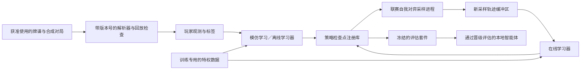

# 打造世界一流的立直麻将 AI

实施与研究蓝图 · 2026 年 10 月 16 日

本方案面向一位使用配备 64 GB 内存的 MacBook Pro、具备丰富编程经验的开发者，由 Codex 协助实现系统。这是一份规划交付物：尚未开始训练、获取数据集、使用付费算力或开展任何外部账户操作。

## 1. 建议方案

构建一个紧凑的神经网络智能体，使其只使用所属玩家能够获得的信息，并以经过验证的立直麻将模拟器为基础。先建立可复现的基线，再通过与多样化对手群体进行自我对弈来改进；只有当受控实验支持时，才加入信念分布建模和选择性模拟推演。

实际推进顺序如下：

**规则与评估 → 获准使用的数据或合成示范 → 模仿学习基线 → 可选的离线强化学习 → 完整比赛的联赛式自我对弈 → 基于信念分布的改进 → 独立评估 → 高效的本地部署。**

你的 Mac 将用于开发、初期训练以及最终运行对局。以一个拥有数百万参数的模型作为起点是合理的。真正棘手的资源约束，是生成足够多样且模拟正确的对局经验，并从中学习，而不是存储最终的神经网络。64 GB 的内存预算并不能确定训练吞吐量；芯片、计算后端、模拟器、批次大小和散热表现都会产生影响。

我会从 **Python/PyTorch 加 Rust 模拟器**开始，在支持的地方使用 MPS 加速，并保留 CUDA 执行路径，供可选的远程训练使用。我不会一开始就编写新的模拟器、训练语言模型或构建大型搜索引擎。

世界领先的牌力是研究目标，不能仅凭某种架构或预算就承诺实现。一个牌力强、独立训练且可复现的智能体，是现实的首个目标。要有说服力地宣称世界最强，必须能与相关对手进行对局，并开展规模足够大、条件受控的评估。

除非明确标注为有来源支持的结果，下文所有规模、超参数、时间安排、阈值和预算都是建议起点，必须依据本项目的实测结果进行调整。

## 2. 精确定义“最强”的含义

从**四人立直麻将、东南战、含赤五牌、带版本号的天凤兼容规则配置**开始。一场比赛称为半庄（hanchan）；其中的一局称为单局（kyoku）。由于连庄、提前结束和加赛取决于具体规则，一场半庄不一定恰好包含八局。

需要区分三个目标：

| 目标 | 训练目标 | 影响 |
|---|---|---|
| 最佳平均名次 | 最大化 `2.5 - final_rank` | 简单的初始研究目标；将每提升一名视为同等收益 |
| 最佳天梯表现 | 最大化一个明确定义的名次积分向量 | 可能会强烈偏向避免第四名 |
| 最佳锦标赛得分 | 最大化最终分数加上赛事规定的确切奖励分 | 可能支持不同的风险选择和终盘决策 |

对于第一个智能体，以平均名次作为主要目标，同时报告其他结果。如果实际部署目标是天梯，再另行训练一个面向天梯的检查点。不要在未说明的情况下改变奖励，然后仿佛任务没有变化一样比较结果分数。

逐步定义成功标准：

1. **正确：**完成整场比赛，没有非法动作、信息泄漏或尚未解决的结算错误。
2. **胜任：**稳定击败随机智能体和合理的启发式智能体。
3. **强大：**在未见过的随机种子上击败冻结的模仿学习基线及独立训练的基线。
4. **具备竞争力：**在相同规则和算力限制下，击败可获得的强力外部检查点。
5. **世界领先的证据：**在与可获得的最强系统对局时取得正面结果，覆盖多种对手组合，经过独立复现，并明确说明哪些对手未纳入评估。

如果 NAGA、MAKA 或其他专有竞争系统无法参与，诚实的结论应是“在这些条件下，在所评估的智能体中最强”。较高的模仿学习分数，或与牌谱分析器高度一致，都不能证明世界领先。

2026 年 10 月的 NAGA 报告说明了目标定义的重要性：其 Ananta 和 Uroboros 变体侧重不同的最终名次结果。报告中的稳定段位估计由内部比较校准得到，不能直接与在人类天梯实战中取得的成绩等同。[NAGA 评估报告](https://naga.dmv.nico/htmls/naga_new_types_league_report.html)

## 3. 我们实际上能够复用哪些资源

| 资源 | 已核实的获取条件／状态 | 预期用途 |
|---|---|---|
| Mortal | 公开的 Rust/Python 源代码，AGPL-3.0-or-later | 参考基线、可能采用的分支，以及模拟器和训练实现的研究对象 |
| Mortal 官方强力权重 | 当前文档所链接的维护者声明表示，没有公开发布计划 | 不将其作为依赖；自行训练，或获取另外获准使用的检查点 |
| MAKA | 雀魂分析功能；未核实到官方源代码／权重发布 | 产品参考，或另行安排的比较对象 |
| NAGA | 托管服务；未核实到公开的训练技术栈／权重 | 获得授权后进行外部比较；其报告并非可不受限制地用于蒸馏的数据 |
| Akochan | 公开代码／参数，附有自定义限制条款 | 仅在许可范围内作为独立的研究对手 |
| Kanachan | 公开的标注、模拟和训练框架；不提供爬虫、数据集或训练好的模型 | 架构参考；复用前先明确代码许可 |
| RiichiEnv | Rust 环境、Python 接口、Apache-2.0、兼容 MJAI | 初期独立环境的首选候选方案 |
| Mahjax | Apache-2.0 许可的 JAX 环境，含 BC/PPO 示例 | 后期可选的远程 GPU 吞吐量实验 |
| MahjongRepository/mahjong | MIT 许可的计分／向听数库 | 用于独立交叉核验计分，不是完整的训练环境 |

来源：[Mortal 仓库](https://github.com/Equim-chan/Mortal)、[权重声明](https://gist.github.com/Equim-chan/cf3f01735d5d98f1e7be02e94b288c56)、[MAKA 发布公告](https://mahjongsoul.com/news/254)、[NAGA 当前服务条款](https://naga.dmv.nico/naga_report/top/)、[Akochan 许可](https://github.com/critter-mj/akochan/blob/master/LICENSE)、[Kanachan](https://github.com/Cryolite/kanachan)、[RiichiEnv](https://github.com/smly/RiichiEnv)、[Mahjax](https://github.com/nissymori/mahjax)、[计分库](https://github.com/MahjongRepository/mahjong)。

有两条实现路线值得考虑，但应选定一条作为主线，而不是立即维护两套完整系统：

- **独立、优先适配 Mac 的路线——推荐：**RiichiEnv、自行实现的观测／动作适配器、紧凑的 PyTorch 策略，以及模仿学习和 PPO 训练。这使我们能够直接掌控 MPS 兼容性和实验设计。
- **Mortal 复现路线：**固定源代码版本，遵守 AGPL 义务，适配与设备相关的代码，训练自己的权重，并复现其实际损失函数。如果复现已有实现最终是最快且经过验证的路径，这条路线就很有吸引力。

已检查的 Mortal 训练器使用所选动作的蒙特卡洛价值目标、离线保守惩罚项，以及名次预测辅助损失。不能将其描述为现成的 PPO 训练方案。其示例配置明确包含占位值。[训练器](https://github.com/Equim-chan/Mortal/blob/main/mortal/train.py)、[示例配置](https://github.com/Equim-chan/Mortal/blob/main/mortal/config.example.toml)

分别检查源代码、权重、数据集和服务的使用许可。一个宽松许可的封装层，不会改变其中机器人本身的许可。在第三方数据获取尚未解决时，我们可以继续使用自己的模拟器生成数据。

## 4. 第一个工程里程碑：确保环境可信

创建一个 `RuleProfile`，为其赋予稳定的标识符，并计算序列化内容的哈希。明确记录：

- 玩家人数、牌集、赤五牌数量、起始分数、比赛长度、结束条件、击飞阈值、加赛和连庄。
- 食断、最低役要求、立直条件、立直棒支付时点、一发失效条件，以及立直后的杠牌限制。
- 振听、同巡振听、立直振听、食替限制、所有鸣牌优先级、同时荣和及途中流局。
- 宝牌／里宝牌／杠宝牌的公开时点、岭上、抢杠、荒牌流局、未听罚符、流局满贯、本场，以及剩余立直棒。
- 符、番、封顶规则、役满复合、包牌支付、最终名次同分处理，以及任何平台特有的例外。

选择一个预设作为起点，然后验证其行为。RiichiEnv 默认使用单局模式，因此必须显式配置完整比赛。其文档中的 `4p-red-half` 模式和天凤规则预设，是初期集成的目标，不能替代我们自己的规则一致性测试。[RiichiEnv 用法与模式](https://github.com/smly/RiichiEnv/blob/main/README.md)

构建三类检查：

1. **确定性测试用例：**为罕见的计分、振听、杠、优先级和终盘情形准备具有预期结果的实例。
2. **牌谱回放一致性：**将合法获取的完整牌谱回放后，应得到相同的分数、合法选项、公开信息和名次。
3. **差分测试：**在相同规则配置下，将计分及选定的状态转移与另一套独立实现的引擎／库进行比较。

每一张实体牌必须恰好位于一个位置。分数加上尚未归属的供托，必须在每次转移前后保持账目一致。策略网络（actor）不得看到对手的暗牌或未来牌山内容。多个实现结果一致是有用的证据，但它们仍可能共享同一种错误；罕见规则测试用例需要独立确定预期结果。

建议的首个发布门槛是：拥有一个经过确认、至少包含 1,000 场完整合成比赛或获准使用的记录比赛的语料库，所有专门针对罕见规则的测试用例通过，且没有任何无法解释的合法动作或结算不一致。持续扩大这些检查；有限测试集中的零错误并不能证明完全正确。

将每一次失败保存为最小可复现牌谱。绝不要通过悄悄删除所有困难实例来“修复”数据集。

## 5. 系统边界



可部署的智能体应实现一个小型接口：

```text
initialize(rule_profile, seat, model_manifest)
observe(player_visible_event)
act(legal_action_candidates, deadline) -> one legal action
finish_match(result)
```

让规则引擎保有最终决定权。模型从合法候选动作中进行选择，而不是自行编造协议消息。协议适配器、特征、模型推理、训练、评估以及可选的搜索，应分别放在不同模块中。

完整模拟器状态属于环境。经过过滤的玩家观测属于策略网络（actor）。特权标签属于独立的训练接口。不要将完整状态对象传给策略，再依赖程序员自律来忽略其中某些字段。

MJAI 是一种数据交换协议及其生态，本身并不是强力玩家。固定所用的协议变体，并测试转换过程。[原始 MJAI 服务器](https://github.com/gimite/mjai)、[格式规范](https://github.com/Cryolite/mjai)

## 6. 数据从哪里来

| 来源 | 价值 | 获取计划 |
|---|---|---|
| 天凤凤凰桌牌谱 | 高水平人类决策和完整比赛结果 | 取得适当许可后，先导入小规模试点数据，再扩大规模 |
| 雀魂高水平牌谱 | 不同的玩家群体和房间实力层级 | 使用获准的导出方式或研究合作安排；尚未核实到可普遍使用的公开研究 API |
| 已有的转换后语料库 | 加快数据发现和预处理实验 | 使用前检查上游权利、来源、完整性和重复项 |
| 我们的启发式智能体 | 可立即获得的低成本示范 | 按照已知规则在本地生成，并记录确切来源 |
| 我们训练的智能体和联赛 | 不断演进、可无限生成的经验，可获得所有隐藏状态标签 | 长期扩大规模的主要来源 |
| 获准使用的第三方机器人 | 更强的示范或对手 | 核实检查点和生成输出的条款；记录确切版本 |
| 同意参与的专家 | 对困难局面的判断和外部评估 | 小规模、有针对性的采集，并独立留出 |

天凤当前的牌谱页面限制某些用途，包括竞争产品，并要求一般麻将应用的开发者联系运营方。其下载规则还要求使用压缩文件、单一会话，并为自动索引更新规定最小间隔。这些数据并非自动成为不受限制的研究数据。[天凤官方牌谱页面](https://tenhou.net/sc/raw/)

在明确获取权限后，仍在维护的 `houou-logs` 工具可作为有用的数据获取参考。它提醒使用者注意再分发限制，并报告部分历史 ZIP 下载端点已不可用。因此，“下载所有年份的数据”并不是可靠的获取假设。[houou-logs](https://github.com/Apricot-S/houou-logs)

具体可调查的数据候选：

- [hhim8826/tenhou-houou-mjai](https://huggingface.co/datasets/hhim8826/tenhou-houou-mjai)：发布者报告其包含 2,120,954 行，以及约 6.29 GB 的 Parquet 分片。数据卡承认存在 48,196 对重复对局；原始 ID 被移除，且缺少逐场时间戳，使按时间划分数据更加困难。该数据集并未授予任何超出上游牌谱已有许可的权利。
- [nikketryhard/tenhou-houou-mjai](https://huggingface.co/datasets/nikketryhard/tenhou-houou-mjai)：按年份／来源组织的存档和转换后的数据流；需要审查实际覆盖范围和来源许可。工具的代码许可并不等于对局数据的使用许可。
- [MahjongLM 数据集](https://huggingface.co/datasets/mitsutani/mahjonglm-dataset/blob/main/README.md)：面向序列的记录，具有多种信息视图及源数据条款。全知视图不能作为合法的策略网络（actor）输入。
- [Kanachan 数据说明](https://github.com/Cryolite/kanachan/wiki/Notes-on-Training-Data)：提供有用的表示方法指导；主仓库不提供语料库。历史上的私人采集数量，不意味着承诺提供可下载的数据集。

对于雀魂，使用适用地区的条款及明确获准的数据获取方式。[日本服务条款](https://dmg.mahjongsoul.com/terms_of_service)

**如果我们无法获取任何第三方数据：**实现合理的向听数／受入／防守启发式策略，收集合成示范，训练初始策略，再通过自我对弈改进。这样可以消除对外部语料库的依赖。它可能降低早期学习的样本效率，因此应通过实验测量这一代价。

不要将人类数据筛选为仅包含获胜者或和牌局。这样会造成基于结果的选择偏差，并丢弃关键的防守实例。房间／段位可以用于指导样本质量筛选，但策略网络（actor）不应接收玩家 ID 或未来结果。

## 7. 数据流水线与数据模式

维护四个层次：

1. **原始数据：** 不可变的原始字节、SHA-256、来源、获取条件，以及在许可范围内保留的时间戳。
2. **规范化数据：** 带版本的事件流、对局语义哈希、精确的规则，以及单独保存源字段的附属文件。
3. **玩家视角：** 使用与实际对弈相同的编码器构造观测。
4. **训练记录：** 决策、目标、掩码、状态转移链接和来源信息。

```text
game_id, source_id, source_timestamp, raw_sha256, semantic_hash
rule_profile_id, converter_version, schema_version, split
hand_id, event_index, player_seat, player_observation
legal_candidates, chosen_candidate, action_identifiable
next_decision_for_same_player, terminated, truncated
terminal_rank, final_scores, optional_auxiliary_targets, validity_masks
policy_versions, behavior_log_probability_if_known, reward_version
```

将完整隐藏状态与随机数生成器（RNG）种子分开保存。人类牌谱通常不包含行为概率；拟合出的模仿模型并不能把估计概率变成真实的动作选择概率。

重放每场被接纳的对局。核对合法动作、牌的身份、副露消耗的牌、分数、信息公开过程和最终名次。记录失败情况和缺失字段。按来源、年份、规则和可识别的动作类别保留拒收／过滤数量，以揭示选择偏差。有些格式会在对局结束后公开隐藏手牌或种子；结束时可获取，并不意味着决策时可获取。

需要注意的标签情况：

- 未被记录的鸣牌并不总意味着“跳过”：它可能被更高优先级的响应抢先处理。将含糊的选择标记为删失数据，在模仿损失以及离线强化学习的已选动作／时序差分（TD）损失中均排除未知动作。有效的辅助目标仍可使用。
- 没有选择空间的协议确认并不是策略性跳过。单独统计强制动作。
- 立直宣言及其对应的舍牌必须采用一致的复合表示或顺序表示。
- 赤五与普通五、吃牌时不同的手牌消耗方式、所有杠的形式，以及有意义的摸切与手切区别，都必须能够正确地往返转换。
- 下一次转移应对应同一玩家的下一次决策，并计入其间的奖励／事件，而不只是下一个全局事件。
- 观测到的结果为实际采取的动作提供标签，并不揭示每个替代动作的价值。

在生成玩家视角、裁剪片段、增强样本或教师标签之前，按完整对局划分数据。使用原始 ID 和语义等价性去重，而不只依赖原始文本哈希。不同转换器可能用不同的序列化方式和信息公开时序来编码同一场对局；应保留对策略有意义的时序。

优先采用按时间划分的训练／开发／测试集，例如截至 2023 年／2024 年／2025 年，前提是可获取的数据覆盖范围支持这种划分。另保留一个时间更晚的前瞻性数据集。如果缺少时间戳，使用有明确记录的分组哈希划分，并且不要称其为按时间划分。只有在存在适当的标识符且允许使用时，玩家互不重叠的测试集才有意义。

只使用经过验证、保持规则不变的变换来增强数据。任意交换花色并不是严格的对称变换，因为绿一色对索子和发财有特殊要求；风牌和宝牌的后继关系也具有意义。对历史、指示牌、赤牌标记、动作、分数／座位元数据及目标进行一致的变换，然后检查合法性／计分不变性。绝不要用未经验证的变换来扩增语料。

## 8. 信息安全也是实验有效性的一部分

对于玩家 `i`，其策略为 `π(a | I_i)`，其中 `I_i` 只包含该玩家在当时合法可知的信息。

允许使用的特征包括自身手牌、摸到的牌、公开的舍牌／鸣牌、公开的立直／宝牌信息、分数、庄家、场风／自风、本场数、供托、剩余牌数，以及从这些信息中推导出的合法动作。

禁止输入策略网络（actor）的特征包括对手的暗手、未来牌山顺序、RNG 种子、尚未公开的里宝牌、未来动作、最终名次、未来分数，或根据之后公开的信息回填的标签。若“这张牌安全，因为没有对手能够荣和它”这类特征是根据隐藏手牌计算得出的，它就是非法信息。

使用**信息集不变性测试**：构造两个合法的底层世界，使策略网络在其中获得的信息完全相同。两者的编码观测、合法动作表示以及确定性 logits 必须一致。同时测试循环状态的初始化与重置行为。

即使各座位共享网络权重，也要分别保存其循环记忆。模拟推演中的对手策略只能获得各自合法的观测。评估器不得通过智能体接口暴露可复现牌山的种子。

仅在训练时使用的隐藏状态目标是有价值的：模型可以学习根据可见证据预测不可见信息。这与把答案直接输入模型有根本区别。

## 9. 首先构建的模型

使用结构化张量和紧凑的事件 token。通用语言模型会显著增加计算量，而它在此任务中的优势尚未得到证实。

### 模型 A：经济型基线

- 覆盖 34 种牌的牌特征平面，并显式表示赤五状态。
- 各玩家的公开特征、自身手牌计数，以及分数／局次等标量特征。
- 紧凑的残差卷积编码器，初始参数量约为 200 万–500 万，具体数量在实现后测量。
- 显式遵守花色边界；对相邻数组索引进行卷积时，不得凭空构造跨花色的顺子关系。
- 对合法候选动作进行评分的策略头，以及基于玩家可见信息的价值头。
- 可选的辅助名次分布头。

可将精确的向听数、合法和牌张，以及基于可见牌计算的受入（有效进张数）作为可选特征。这些特征源于允许使用的信息，可以减少模型需要自行发现的内容。之后再对其做消融实验；移除有用特征并不是“正规的 AI”的前提。

### 模型 B：事件历史挑战模型

- 四至六个 Transformer 模块，宽度 256，初始使用四个注意力头，前馈层宽度为 1,024。
- 手牌／牌嵌入、玩家相对标识、事件类型、赤牌标记、摸切／立直／鸣牌信息，以及时间位置。
- 独立的标量上下文编码器。
- 起步时每个样本使用 256–512 个事件 token，并显式处理更长的历史；不得静默截断。
- 只编码当前可获得的前缀。在合法信息前缀内使用双向注意力是可以的；注意力访问未来牌谱事件则不可以。
- 即使对较早的历史进行摘要或裁剪，也要保留完整的公开状态摘要。

将约 500 万–1,500 万个参数视为设计预算，而不是保证达到的参数量或实力目标。分别在相同训练计算预算和相同推理预算下，与模型 A 进行比较。

### 动作表示

枚举所有合法候选动作，并附上描述符：动作类型、牌、消耗的牌、赤牌标记、来源座位，以及所有相关的舍牌／立直元数据。使用策略为每个候选动作评分。如果固定动作头的映射覆盖所有必要区别，并经过穷尽测试，也可以采用固定动作头。

不要让模型学习合法性。不要以为选择舍牌就覆盖了鸣牌、立直、杠、跳过、荣和、自摸和途中流局。在规则允许时，合法的放弃和牌决策应始终能够被表示。

### 有用的辅助头

预测最终名次分布、对手的听牌概率、牌的危险度，以及以放铳为条件的预期损失。合成的完整状态数据可以为其中部分目标提供精确标签，但所有预测都必须来自策略网络的合法输入。

区分以下定义：“对手已听牌”“这张牌能够组成有役的和牌”“考虑振听后荣和是否合法”，以及“对手是否真的会选择荣和”，这些是不同的目标。对不可获得或含糊的标签使用掩码。除了准确率，还要评估校准程度。

## 10. 阶段 A——基线与行为克隆

创建四个可复现的对手：随机选择合法动作的智能体、基于向听数／受入的启发式智能体、保守防守变体，以及冻结的首个神经网络检查点。它们可以暴露明显的学习失败，并在无法获取外部权重的情况下提供初始联赛。

先使用 5,000–10,000 场完整的获准使用或自行生成的对局验证流水线。随后使用约 100,000 场对局进行第一次正式的模仿学习比较；只有当吞吐量与学习曲线提供支持时，才增加至 300,000 场或更多。

对于合法候选集合 `A(I)` 中的示范动作 `a*`：

```text
L_BC = -log πθ(a* | I)
```

初始配置：

| 参数 | 初始选择 |
|---|---|
| 优化器 | AdamW |
| 学习率 | `3e-4`；若不稳定，则对比 `1e-4` |
| 权重衰减 | `1e-4` |
| 有效批大小 | 256–1,024 个决策；根据实测内存设置微批大小 |
| 梯度裁剪 | 全局范数 1.0 |
| 精度 | 首先使用 FP32；通过一致性检查后再降低精度 |
| 训练轮数 | 初始遍历 1–3 次；根据开发集表现选择 |
| 种子 | 调试用一个，正式比较用三个 |

按决策类型进行适度采样，避免稀有动作被大量舍牌淹没，但要保留目标训练分布，或对偏离该分布的情况作校正。同时报告自然频率指标与均衡指标。将含糊的动作标签排除在模仿损失之外；它们仍可支持其他有效目标。

首先在一个极小的固定批次上进行过拟合。然后测量各动作类型的负对数似然、top-k 准确率、校准程度、合法性，以及实际对局表现。使用完整且符合实际的轨迹训练，并单独保留强制选择的统计信息，避免表面准确率虚高。

晋级要求在未见过的种子上，相对于启发式对手组取得进步。仅有对人类动作的模仿准确率不能作为实力门槛。

在采用稀疏奖励的 PPO 之前，先显式使用完整对局结果训练价值／名次头。仅靠 BC 动作损失无法初始化一个有用的价值评估器（critic）。针对所选效用，对观测到的终局回报做回归，或预测最终名次概率并据此计算期望效用。使用留出数据进行校准测试；这些目标最初反映的是示范／行为策略，因此随着实际采取动作的策略和对手组合发生变化，需要更新价值评估器。

## 11. 阶段 B——可选的离线强化学习

离线强化学习可以从固定语料中提取更多价值，但并不是开展有效自我对弈的必要前置步骤。在笔记本电脑上，我会先建立 BC→PPO 这一最简单的端到端学习系统，然后在获得授权数据后，对加入离线阶段进行比较。

两个候选实验是保守 Q 学习式正则化和隐式 Q 学习。CQL 针对数据支持不足的动作价值过于乐观的问题；IQL 使用价值的期望分位数（expectile）和优势加权模仿，在价值学习步骤中不显式对数据集中未出现的动作进行优化。这两篇论文都不能保证在我们的非平稳多人环境中取得良好表现。[CQL](https://arxiv.org/abs/2006.04779)、[IQL](https://arxiv.org/abs/2110.06169)

对于小规模离散 CQL 实验，保守惩罚项的形式为：

```text
α × [对所有合法动作 a 的 Q(I,a) 计算 logsumexp - Q(I,a_observed)]
```

将它与经过明确设计的回报目标或 Bellman 目标结合。如果复现 Mortal，应使用它实际的目标构造方式，而不是替换成同名的通用算法。对于新的自举实现，应对目标网络、终止处理和合法动作掩码进行版本管理。

在相同总计算预算下，比较 BC、BC+离线强化学习和 BC+自我对弈。检查 Q 值校准与分布外动作。历史人类对手是数据集动态的一部分，因此离线阶段取得的提升仍必须在针对预期对手池的实际模拟对局中成立。

不要把不可靠的离线策略评估作为唯一晋级门槛。模拟器为我们提供了直接评估的途径。

## 12. 阶段 C——完整对局自我对弈

最初的独立实现采用 PPO，因为它的更新方式和诊断相对直接。这是工程上的起始假设；如果表现进入平台期，我们会将其与已经建立的基线进行比较。[PPO 论文](https://arxiv.org/abs/1707.06347)

开始时，训练一个指定的学习座位，与三个冻结对手对弈，并在不同对局间轮换座位。只收集正在被优化的行为策略所采取的动作。之后，在各座位的策略版本和轨迹语义正确的前提下，再收集多个学习座位的数据。不要仅仅因为旧对手的动作出现在重放数据中，就对这些动作应用同策略 PPO。

```text
重复执行：
    保存学习者策略与联赛采样分布的快照
    生成完整对局轨迹，或具有正确自举估计的轨迹片段
    记录玩家观测、合法动作掩码、选定动作、
         旧策略的动作对数概率、价值、策略版本与结果
    分别构造各玩家的优势与回报
    进行少量 PPO 小批次更新轮次
    丢弃过期的同策略采样轨迹
    定期在开发种子上评估冻结的候选模型
    只有通过预先规定的比较后才允许模型晋级
```

在轨迹采样边界之间持续保留环境状态。一个训练批次结束并不意味着对局终止。在对局真正终止时，自举价值为零；在因运行管理而截断时，应正确自举并标记截断。绝不要把尚未完成的半庄转换成流局或虚构的最终名次。

测试以下情况：学习者最后一次动作之后，对手结束了对局，此时终局奖励仍应归入学习者的最后一次转移。如果初始价值评估器无法有效传播稀疏结果，则比较接近 1 的 GAE 参数与完整对局的蒙特卡洛目标。

对于已收集的动作，令 `ρ = exp(log π_new(a|I) - log π_old(a|I))`。最大化 PPO 项 `min(ρ × advantage, clip(ρ, 1-ε, 1+ε) × advantage)`，加入熵奖励，并最小化价值评估器的回报预测损失。计算旧／新概率时使用完全相同的合法动作掩码。在各玩家自己的决策时间线上计算 GAE；当 `γ=1` 时，决策之间的间隔不会引入对更快结束单局的非预期偏好。起步时使用处理合法历史前缀的前馈编码器，使循环网络的批处理不会成为额外的错误来源。

初始本地设置：

| 参数 | 试验范围 |
|---|---|
| 活跃环境数 | 初始 32–128；仅在批处理有帮助时增加 |
| 模拟器工作进程数 | 从 4 开始；根据可用 CPU 资源对 2/4/8 进行基准测试 |
| 每次更新的学习者决策数 | 初始 8,192–32,768 |
| PPO 训练轮数 | 2–4 |
| 小批大小 | 内存允许时为 256–1,024 |
| 策略学习率 | `1e-4`，将 `3e-4` 作为消融实验 |
| 裁剪比率 | 0.1–0.2 |
| GAE lambda | 0.95–0.99；比较长对局的回报估计 |
| 折扣 | 对有限半庄的名次目标使用 `γ = 1` |
| 熵系数 | 从约 0.01 开始；结合考虑动作数量的诊断进行调节 |
| 价值系数 | 初始 0.5，根据目标尺度调整 |
| 全局梯度范数 | 1.0 |

这些值并不是各自独立最优的。第一次参数搜索保持小规模：在大量尝试不同架构之前，先研究学习率、轨迹采样规模和更新轮数。

记录近似 KL、发生裁剪的比例、各决策类型的熵、解释方差、回报尺度、actor 版本滞后、非法动作、吞吐量，以及对手构成。保存优化器和 RNG 状态以便恢复。如果必须采用异步 actor，应限制版本滞后，或有意识地采用异策略方法；不要假设过期的 PPO 数据无害。

## 13. 覆盖完整对局的奖励设计

初始任务采用以下终局奖励：

```text
第一名: +1.5    第二名: +0.5    第三名: -0.5    第四名: -1.5
```

这会直接优化平均名次。对于天梯智能体，将其替换为明确指定并归一化的天梯效用；对于比赛智能体，则使用比赛得分。将目标写入每个检查点的清单。

避免长期保留随意设定的额外奖励，例如减少向听数、宣告立直、赢下任意一局，或避免每一次放铳。这类奖励可能教会模型错误的取舍。低放铳率是一项诊断指标，并不能证明牌力强。

先使用终局奖励与训练好的价值基线。如果稀疏反馈成为瓶颈，再测试基于势函数的奖励塑形：

```text
r'_t = r_t + γ Φ(I_{t+1}) - Φ(I_t)
```

将终局势函数值设为零，并在每条采集轨迹中使用固定且有版本记录的势函数。当 `γ=1` 时，完整轨迹上的塑形项会相互抵消，只剩下初始状态项；只要实现正确，就能保留原定的总回报偏好。在轨迹采样的截断处，应一致地使用自举估计。这并不能证明整个多人学习过程会收敛。[基于势函数的奖励塑形](https://ai.stanford.edu/~ang/papers/shaping-icml99.pdf)

独立的对局价值模型可以根据分数、庄家、场局、本场数和立直供托预测最终名次。这是受 Suphx 全局奖励预测启发的一个有用方向。Suphx 还研究了全知指导和运行时适应；其历史结果为深度强化学习提供了有力先例，但并不是一套可复现的、能达到当前冠军水平的方案。[Suphx 论文](https://arxiv.org/abs/2003.13590)

## 14. 对手联赛

只与最新模型的副本对弈，可能导致策略循环，或形成只在狭窄范围内有效的约定。应使用一个规模较小、长期保留的策略群体。

对手阵容的初始采样建议：

- 40% 使用近期稳定快照。
- 30% 使用历史快照，跨多个代际采样。
- 20% 使用冻结的参考智能体，包括启发式智能体和获准使用的外部对手。
- 10% 使用纳入训练的针对性利用型智能体，或采用非典型策略的变体。

这些比例只是起始分配。将它们设为可配置项，并记录实际采样的阵容。在一场对局内固定对手检查点。不同座位之间不得共享私有信息、隐状态记忆或通信通道。

先保留 8–16 个快照，并建立一个小型交叉对弈矩阵。保留策略上有明显差异的旧策略，而不只是保留最新的八个文件。定期针对当前冠军训练一个应对智能体；如果它揭示了弱点，就将其加入训练池，并重新评估更广泛的表现。

保留的快照不必全部驻留在加速器内存中。按检查点对推理队列分组，限制驻留模型数量，并对实际的异构对手组合进行基准测试。包含许多模型的联赛会使批次碎片化，可能抵消使用同一策略的四个副本时测得的吞吐优势。

维护一组独立的留出对手。新发现的测试对手一旦被用于训练，就会成为开发对手，不再算作未经使用的评估证据。

目标是对多样化玩家保持稳健。不要根据四人麻将中的联赛结果，声称模型达到了纳什均衡、获得了精确的可利用度，或具备不可战胜的策略。

## 15. 按优先级排列的研究升级

### A. 更好的不确定性与防守建模

利用合成数据中的隐藏状态标签，训练对手听牌、待牌以及放铳损失预测。在联赛对手和留出对手上都进行评估。将神经网络的校准表现与简单基线比较；预测得更好不一定能提高决策效用。

显式的隐藏状态采样器必须生成与所有可见牌和事件一致、且**联合合法**的暗手与牌山。如果分别根据各玩家牌张的边缘分布独立采样，可能产生不可能存在的世界。先以满足约束的均匀分配作为基线，再加入动作历史作为条件。记录采样器的校准表现和拒绝率。

### B. 使用特权信息进行训练

比较仅使用玩家可见信息的价值评估器（critic），与一个独立的、能在训练时使用完整模拟器状态的特权价值评估器。策略网络（actor）及其部署时的编码器仍然只能使用观测信息。保持输入路径分离，并检查梯度和数据的边界。以动作发生前的隐藏状态为条件的价值基线可以帮助降低方差，但仍需通过消融实验检查实际近似误差与自举误差。

全知教师蒸馏是另一项实验：掌握更多信息的教师可以指导学生，但其决策可能依赖于学生无法推断的事实。在合法信息范围内训练和评估学生，不要声称全知教师的实力会自动迁移给学生。[变分全知指导](https://openreview.net/forum?id=pjqqxepwoMy)

### C. 选择性地进行以信念分布为条件的模拟推演

只有在策略已经足够强后才加入搜索。首先研究影响较大的决策：面对立直时继续进攻、宣告立直、关键的鸣牌或杠牌，以及对局后期与名次变化有关的门槛。

建议的首个实验：

1. 保留策略排名最高的 2–4 个动作，以及战术上相关的其他合法选项。
2. 采样 16–64 个一致的隐藏世界。
3. 对每个候选动作，使用仅能看到自身观测的后续策略进行模拟；复用初始世界，通过配对降低方差。
4. 在同一目标下评估终局效用，或经过校准的叶节点价值。
5. 测量额外计算是否能在决策时限内改善完整对局的结果。

相关的估计值，是每个候选动作在多个一致世界中的价值平均值。不要让真实策略网络在看到每个采样隐藏世界后，选择不同的根节点动作，再将这些完全信息下的最佳情况取平均。这会造成策略融合与过度乐观。

每位模拟玩家都依据自己的信息行动。真实玩家在模拟推演中的策略，不得仅仅因为模拟器保存了隐藏手牌，就访问这些手牌。信念分布近似和有限深度的价值估计仍然可能有偏差；这是一项实验，并不保证安全地提升表现。

置信度低或受时限限制的搜索，应回退到已经验证的策略。额外搜索应提高实测的每毫秒效用收益。ReBeL 是有用的理论背景，但其均衡结论针对的是双人零和博弈，不能直接迁移到四人立直麻将。[ReBeL](https://arxiv.org/abs/2007.13544)

### D. 将高成本获得的改进蒸馏到本地模型

如果远程训练的更大模型或搜索策略更强，就生成获准使用的教师轨迹，训练一个紧凑的学生模型。在可获得时使用动作分布和价值目标，然后通过自我对弈微调。独立地重新评估学生模型：蒸馏和量化都可能改变其策略实力。

## 16. 你的 64 GB MacBook Pro：具体执行方案

确切的芯片型号和软件栈尚未确定。如果是受支持的 Apple Silicon 机器，就使用 PyTorch 的 MPS 后端；否则在本地使用 CPU，并更早考虑远程 GPU 训练。PyTorch 支持通过 Metal 进行 GPU 训练，但必须针对我们的模型测试后端和算子的覆盖情况。[Apple PyTorch 指南](https://developer.apple.com/metal/pytorch/)

本地训练使用原生 macOS。为 Linux 保留可移植的 CPU/CUDA 路径。不要默认通过 Linux Docker 容器获得 Apple GPU 加速。审查引入的代码，检查无条件执行的 `torch.cuda` 操作、CUDA 自动精度转换及梯度缩放器、设备专属同步，以及关于编译的假设。Mortal 的在线客户端包含 CUDA 专属调用，因此只改一个设备字符串，并不足以证明代码可以移植。[Mortal 客户端源码](https://github.com/Equim-chan/Mortal/blob/main/mortal/client.py)

MPS 不支持 float64 张量。Mortal 的全局名次预测器和训练奖励处理路径使用双精度，因此复现它还需要进行精度审查。将必要的双精度预处理保留在 CPU 上，或者实现经过归一化的 FP32 等价计算，并在使用 MPS 前验证输出和训练行为。不要悄悄转换所有数据类型，然后假定结果一致。[MPS 限制](https://docs.pytorch.org/docs/main/notes/mps.html)、[Mortal 模型](https://github.com/Equim-chan/Mortal/blob/main/mortal/model.py)、[Mortal 训练器](https://github.com/Equim-chan/Mortal/blob/main/mortal/train.py)

文档将 JAX-on-Metal 标为实验性功能。因此，在精确的兼容性测试通过之前，我不会让 Mahjax 成为本地关键执行路径的一部分。[JAX 安装支持](https://docs.jax.dev/en/latest/installation.html)、[Apple JAX 指南](https://developer.apple.com/metal/jax/)

MLX 是一个值得考虑的、面向 Apple 的替代训练框架，支持自动微分和共享内存执行；其当前仓库也记录了 Linux 后端。只有在实测确认 MPS 是瓶颈时，我才会用一个等价的小模型对其进行基准测试。从 PyTorch 开始，可以更容易地复用已经检查过的麻将实现，并进行模型比较。更换框架需要获得可测量的收益，足以抵消新增的实现和一致性验证工作。[MLX 仓库](https://github.com/ml-explore/mlx)

本地配置：

- 从模型 A 和 FP32 开始；在同一批测试样本上，检查 CPU/MPS 的前向输出、掩码、损失、梯度以及若干优化器更新步骤是否在数值容差内一致。
- 同时测试单次决策的 CPU 推理和批量 MPS 推理。对于很小的请求，GPU 调度开销可能占主导。
- 为模拟器工作进程使用集中式推理批处理器；避免每个工作进程各自加载 GPU 模型、争夺内存。
- 从少量工作进程和有界队列开始。将数据解析与特征生成放在 CPU 进程或 Rust 中，避免在热点循环中用 Python 逐事件处理所产生的开销。
- 流式读取紧凑记录。使用整数或类别表示，并按批次生成稠密浮点张量。
- 初始目标是将应用总内存占用控制在约 32–40 GB，为操作系统、编辑器、缓存和突发需求留出空间。测量真实的峰值内存，而不是把 64 GB 当作专用加速器内存。
- 接通电源，持续运行 20–30 分钟的基准测试；区分预热、编译、稳态吞吐和发热降速。
- 定期保存检查点，并在正常中断时保存。训练应能在休眠或重启后恢复，同时保留该次运行的标识。

当前项目文件夹位于 iCloud Drive 中。如果需要，可以将源码和报告保留在那里，但应将活跃数据集、经验回放缓冲区、临时分片和频繁写入的检查点放在可配置的、不同步的本地数据目录或高速外接 SSD 上。在实现阶段选择并授权该路径；不要让同步流量决定训练性能。

容量示例：100,000 场对局 × 每场保留 400 个决策 × 每个物化样本 2 KB，约为 80 GB。这些是假设，之后应以试验测量结果替代。压缩后的原始日志可能小得多，而解码后的张量和重复保存的历史可能大得多。

## 17. 测量训练成本，而不是猜测

分别对以下项目进行基准测试：

1. 使用简单策略时，模拟器每秒处理的事件数。
2. 使用实际策略时，每小时完成的完整半庄数。
3. 每秒生成的学习座位决策数。
4. 每秒处理的监督学习决策样本数。
5. 包括推理、数据传输和优化在内的端到端强化学习吞吐量。
6. 部署时的决策延迟：中位数、p95、p99，以及超时率。

公布单位。“一百万步”可能指环境事件、一个座位的决策、全部四个座位的决策，或优化器重复使用的样本。它们不能互换。

对于 `N` 个不同的训练决策、`E` 个训练轮次，以及实测监督学习速率 `q`：

```text
supervised_seconds ≈ N × E / q
```

对于 `N` 个轨迹采样决策，以及实测端到端强化学习吞吐量 `q_RL`：

```text
RL_seconds ≈ N / q_RL
```

仅作示例：1 亿个轨迹采样决策，以每秒 1,000 个的速度处理，约需 27.8 小时；以每秒 100 个的速度处理，约需 11.6 天。这些只是算术情景，不是对 Mac 性能的估计。还需计入评估、失败的运行、预处理和多个随机种子的成本。

初始样本规模阶梯：

| 运行类型 | 建议规模 | 目的 |
|---|---|---|
| 冒烟测试 | 100–1,000 场对局；极小的学习批次 | 检测集成故障 |
| 本地学习试验 | 100 万–1,000 万个不同决策 | 确认学习能够改善对局表现 |
| 正式本地运行 | 若实测耗时可接受，使用 1,000 万–1 亿个决策 | 比较一至两个有竞争力的配置 |
| 远程扩展 | 逐步扩展至 1 亿–10 亿个决策 | 在获得本地证据后检验规模扩展假设 |

这些是实验资源分配，并不是达到世界级牌力所需数据量的估计。如果置信区间和学习曲线表明，再进行一次十倍规模的运行并不划算，就应停止或改变方向。

已发表的参考数据与硬件配置密切相关：Mortal 文档记录，在 RTX 4090 加 Ryzen 9 7950X、使用大批次时，吞吐量最高可达每小时 40,000 个半庄。这不能预测我们的笔记本训练吞吐量。[Mortal 基准测试说明](https://mortal.ekyu.moe/)

作为历史规模参考，Suphx 的受控强化学习实验报告称，每个变体在两天内训练了 150 万场对局，使用四块 Titan XP 学习 GPU 和四十块 K80 工作 GPU。硬件与算法已经发生变化，但这仍提醒我们，不应承诺凭一次短时间的笔记本训练就达到前沿水平。其高成本的初始手牌适应实验，也不适合作为默认的本地推理策略。[Suphx 实验设置](https://arxiv.org/html/2003.13590v2)

Mahjax 报告称，在八块 A100 上使用随机策略，含赤牌规则模拟器的吞吐量约为每秒一百万步。其报告的学习实验采用简化的无赤牌单局任务，以启发式模仿学习初始化，并使用固定基线对手。该论文证明了模拟吞吐量的潜力，而不是完整半庄下的世界级训练能力。[Mahjax 论文](https://arxiv.org/html/2605.20577v1)

## 18. 其他训练路线

**路线 1——完全本地训练：**适合开发、紧凑模型、小规模对比实验，以及正式的研究原型。只有完成性能分析后，才应安排较大批次的隔夜运行。每项实验同时设置决策数和实际耗时上限。在经过评估之前，世界领先牌力仍未得到证明。

**路线 2——Mac 加短期租用 GPU：**如果本地结果有希望，但实验耗时过长，这是推荐的升级路线。使用一块在 Linux 上运行的 NVIDIA GPU，其显存应足以承载实测工作负载，同时配备足够的 CPU 核心用于模拟，以及高速本地存储。先运行一个小规模的相同基准测试。如果租用的 GPU 环境缺乏足够的 CPU 或存储性能，整体速度可能比预期更慢。

打包固定版本的源码、依赖锁定文件、规则和特征模式定义、模型配置、一小组获准使用的测试样本，以及恢复训练用的检查点。验证 CPU/MPS/CUDA 的结果在容差内一致。比较每百万个有效学习决策和每场完整评估对局的成本，而不是宣传中的 GPU 规格。

根据实测 GPU 小时数制定预算。例如，500 小时按假设的每小时 $1 计算为 $500；按每小时 $3 计算则为 $1,500，尚未计入 CPU、存储、传输和税费。这些是示例价格，不是供应商报价。在有了具体运行方案后获取当时报价；开始付费任务前，设置支出上限、检查点保存间隔和关机条件。

**路线 3——学术计算资源：**如果这个项目属于大学或研究机构，应带着可复现的基线、学习曲线和预期决策预算申请算力配额。这通常比为了一个未明确定义的“最强 AI”申请硬件更有依据。届时需要核实访问权限和资助机会。

**路线 4——迁移已有训练检查点：**如果能够合法获得强检查点，就对其微调，并记录来源。这可以降低启动成本，但会改变“从头训练”的含义。如果这种区别在学术上重要，就保留一个从头训练的基线。

**路线 5——远程教师、本地学生：**在其他地方进行高成本训练或搜索，蒸馏为紧凑策略，再在 Mac 上运行最终智能体。提供模型推理服务的机器，不必就是训练该模型的机器。

在单机试验明确瓶颈之前，不要购买集群。多 GPU 训练是后续选项，只有实测扩展收益足够时，才值得承担分布式系统的复杂性。

## 19. 能够支撑实力结论的评估

将开发阶段的对战评估与锁定的最终测试分开。在最终运行前，固定规则配置、奖励、对手、模型哈希、随机种子、算力限制和统计分析方法。

评估多种牌桌配置：

- 一个候选模型对阵三个固定基线的副本，并均衡候选模型的座位。
- 一个候选模型对阵不同强对手组成的混合阵容。
- 同一牌桌上安排多个候选模型副本，以暴露其对同桌策略组合的敏感性。
- 由多个独立开发的策略组成的联赛。
- 留出的人类风格或非常规智能体，用于探查分布偏移。

如果智能体只与自己的副本对弈，那么由对称性可知，其平均名次为 2.5；这个结果不能证明实力提升。同样，对手池逐渐变弱时获得更高回报，也不能作为实力提升的证据。

使用配对的随机种子和座位轮换来降低方差。为连庄产生的追加单局以及延长赛预先定义可复现的随机牌山序列。鸣牌会改变谁摸到哪张牌以及对局持续时间，因此，共用随机种子可以降低方差，但不能保证轨迹完全一致。

比较候选模型 A 和 B 时，应在配对的种子组上，分别将二者放入相同的评估座位和对手配置中。不能把四个相关的座位或轮换结果当作独立对局。应以独立种子组为单位进行自助法重采样（bootstrap）或统计分析。必要时使用独立的推理随机数流，并予以记录。

主要报告指标：

| 指标 | 含义 |
|---|---|
| 平均名次及置信区间 | 主要的名次优化目标 |
| 指定效用的平均值 | 若目标不同，则对应实际的段位赛或赛事目标 |
| 一位率、二位率、三位率、四位率 | 展示单个标量所掩盖的风险分布 |
| 分数变化、和牌率、放铳率、和牌得点 | 用于诊断行为，不能独立证明实力 |
| 按对手和座位细分的结果 | 暴露只对少数对手有效的优势和座位偏差 |
| 延迟、超时、不合法动作 | 运行层面的公平性与可靠性 |
| 不同训练种子之间的波动 | 区分稳定的算法与偶然表现出色的检查点 |

下面的样本量示例说明，几百场对局不足以识别微小提升。假设名次方差约为 1.25，那么单个智能体的平均名次 95% 置信区间半宽约为 `1.96 × sqrt(1.25/N)`。达到 ±0.01 需要约 48,000 场独立对局。这是估计精度的计算，并不是两个智能体比较时的统计功效计算。如果使用两个相互独立且样本量相同的样本，为达到同样的差值估计精度，每组所需样本量大约翻倍；配对设计则应使用实测的配对差值方差。

对于显著性水平为 5%、统计功效为 80% 的双侧检验，配对设计的近似公式为：

```text
independent_seed_blocks ≈ (1.96 + 0.84)^2 × variance(paired_difference) / effect_size^2
```

应在先导实验中估计该方差。不要预设座位轮换能够带来某个固定幅度的方差下降。粗略的评估门槛可以是：1,000 场用于冒烟测试，5,000–20,000 场用于筛选较明显的提升，50,000–200,000 场甚至更多用于实力接近的最终比较；实际数量应通过统计功效分析调整。

为确认性测试保留新的随机种子。反复查看普通置信区间，并在某次结果刚好转为正向时停止，会提高假阳性率。应使用预先确定的样本量，或有效的序贯检验方法。在大量实验中，要区分探索性发现与预注册的确认性结果。报告置信区间和多个训练种子的结果；通用强化学习评估文献已经说明，单凭点估计进行比较可能非常不稳定。[统计评估论文](https://arxiv.org/abs/2108.13264)

### 模型晋级规则

对于冻结的候选模型，要求：通过正确性测试集；满足部署预算；主要效用按预先规定的统计标准提升；在混合对手评估中，不出现预先规定的不可接受退步；并且结果能够在多次正式训练中复现。如果证据不足，则保留此前的最优模型。

公开进行机器人对战时，应使用明确接受机器人的平台或赛事。RiichiLab 提供开放的机器人竞技场以及 MJAI/WebSocket 接口，可以作为外部验证场所，但不能视为覆盖全球所有系统的统一排名。[RiichiLab](https://riichi.dev/docs)

## 20. 实验矩阵与科学贡献

初期每次只改变一个主要因素：

| 实验 | 比较内容 | 要回答的问题 |
|---|---|---|
| E0 | 启发式策略与随机策略 | 环境和指标是否合理？ |
| E1 | 紧凑残差网络的行为克隆与启发式策略 | 训练流程能否学到有效打法？ |
| E2 | 在相同预算下比较残差网络与小型 Transformer | 事件序列建模能力是否值得其成本？ |
| E3 | BC 与 BC+离线 RL | 对静态数据进行优化能否带来额外价值？ |
| E4 | BC 与 BC+PPO | 在线学习是否真正提高效用？ |
| E5 | 仅与最新模型自我对弈与联赛训练 | 对手多样性能否提高留出评估中的鲁棒性？ |
| E6 | 仅使用玩家可见信息的价值评估器与特权价值评估器 | 仅在训练中提供额外信息能否降低样本成本？ |
| E7 | 不使用信念辅助任务与使用经过校准的信念预测头 | 隐藏状态预测是否改善决策？ |
| E8 | 仅使用策略与增加选择性模拟推演 | 测试时增加计算量能否提升实力？ |
| E9 | 较大的教师模型与本地学生模型 | 压缩后能保留多少实力？ |

先通过小规模先导实验淘汰明显较差的变体，再为入围方案分配三个训练种子以及更充分的评估。既比较相同数量的独立决策样本，也比较相同实际运行时间或算力预算下的结果。记录失败的实验及置信区间。

最清晰的初始研究问题是：**在固定的笔记本级算力预算下，仅在训练阶段使用的隐藏信息与对手多样性，能否提高样本效率和鲁棒性？** 相比宣称提出一种通用的新 AI 架构，这个问题更容易通过实验检验。

麻将为部分可观测性、长时程目标、风险敏感决策以及考虑不确定性的规划提供了可控试验环境。这些思想可能与 AI for Science 有关，但仅在麻将上取得成功，并不能证明它对科学发现有用。若要建立更有力的科学联系，应将相同方法应用于另一个涉及高成本观测或不确定序贯实验的任务。

## 21. 建议的代码仓库结构

```text
configs/          规则、模型、奖励、训练、联赛、评估配置
environment/      固定版本的引擎适配器、事件类型、观测边界
data/             解析器、来源清单、去重、数据划分、回放检查
features/         紧凑编码、事件 token、合法动作描述
models/           策略、价值、辅助预测器
training/         行为克隆、离线实验、PPO、检查点恢复
selfplay/         工作进程、批量推理、策略注册表、联赛采样
evaluation/       配对对战、置信区间、报告、固定测试用例
search/           可选的隐藏状态采样器和模拟推演评估器
inference/        本地智能体与 MJAI 适配器
tests/            规则、回放、可观测性、后端一致性、学习冒烟测试
reports/          实验登记表、模型卡、证据与局限性
```

大型数据和检查点应存放在 Git 之外，也应避开正在同步的目录。登记表记录源代码提交、依赖版本、规则与特征哈希、数据清单、父检查点、奖励、优化器状态、随机种子、训练决策数、算力用量、评估协议和模型校验和。

以下是建议实现的命令，并非目前已经存在的命令：

```text
mahjong-ai doctor
mahjong-ai validate-rules --profile tenhou-4p-red-half
mahjong-ai data audit --manifest ...
mahjong-ai data build --manifest ... --split ...
mahjong-ai benchmark --device mps --config ...
mahjong-ai train bc --config ...
mahjong-ai train ppo --resume ... --config ...
mahjong-ai evaluate --candidate ... --panel ... --seeds ...
mahjong-ai export --checkpoint ... --target local
```

`doctor` 应报告后端是否可用，但不能声称“可用”就证明其计算正确。`benchmark` 应记录经过设备同步后的计时、模型规模、内存使用和实际对局吞吐量。`export` 在替换本地最优模型之前，必须运行动作与 logit 一致性检查，以及整场对局层面的回归检查。

## 22. 里程碑与时间安排

以下建议以 12 周为第一个研究周期，前提是数据可获取且实测训练速度允许。这并不是承诺在 12 周内达到世界领先水平。

| 时间 | 交付物 | 完成条件 |
|---|---|---|
| 第 1 周 | 规则规范、引擎比较、Mac 基准测试、数据登记表 | 明确的一套规则配置、可确定性复现的完整半庄、可信的资源测量 |
| 第 2–3 周 | 回放与数据流程、动作适配器、启发式对手组 | 固定用例通过验证；策略网络无信息泄露；可用的合法训练样本 |
| 第 3–4 周 | 紧凑的 BC 基线 | 在留出种子上击败启发式对手；具备完整可复现的检查点 |
| 第 5–6 周 | PPO 学习器与规模受控的联赛 | 明确优于冻结的 BC，或者已诊断失败原因 |
| 第 7–8 周 | 奖励与联赛消融实验、资源决策 | 得到最佳可重复的本地方案；有证据判断是否需要远程训练 |
| 第 9–10 周 | 一项研究改进 | 在相同预算下获得价值评估器、信念建模或搜索方案的实验依据 |
| 第 11–12 周 | 最终确认、部署、报告 | 冻结测试结果、模型卡、本地智能体、可复现的发布材料 |

前十个工作日应安排为具体任务：

1. 确认芯片与后端，选择规则配置和主要效用，建立项目与实验清单。
2. 集成选定的引擎，使用确定性的随机种子运行随机策略的完整半庄。
3. 实现玩家信息边界，以及动作编码与解码的往返检查。
4. 加入启发式对手、分数核对，以及核心罕见规则的固定测试用例。
5. 测量实际本地模拟与批量推理性能，确定内存和数据预算。
6. 实现标准化记录、来源追踪、语义去重以及数据集划分。
7. 导入小规模获授权数据，或生成合成示范数据；将不一致记录隔离。
8. 构建紧凑的策略与价值模型，在极小批次上进行过拟合测试，并比较 CPU/MPS 行为。
9. 完成第一次 BC 训练，生成分层验证报告。
10. 对固定的启发式对手组开展座位均衡的比较，并根据实测结果确定下一阶段样本预算。

如果人类数据的获取问题尚未解决，第 7 天使用合成数据，计划继续推进。如果 MPS 不支持我们的具体模型，或者实际速度较慢，则先使用 CPU 验证正确性，并在投入更大实验前对小规模远程 GPU 任务进行基准测试。

## 23. 主要失败模式及应对

| 失败模式 | 可观察证据 | 应对措施 |
|---|---|---|
| 隐藏信息泄露 | 信息集不变性测试失败；脱离回放后出现异常的性能崩塌 | 修复观测边界，将受影响结果判为无效，重新训练 |
| 模拟器错误 | 回放或分数不一致，或出现不可能的牌状态 | 修复并重新运行固定用例，然后再继续学习 |
| 目标错误 | 单局期望收益较好，但最终名次较差 | 使用整场效用，检查终盘案例 |
| 模仿学习达到上限 | 与人类动作一致率较高，但竞技实力不再进步 | 加入自我对弈，并评估实际结果 |
| 自我对弈出现循环 | 能击败近期快照，却输给旧模型或混合对手 | 保留联赛多样性和针对性应对智能体 |
| 利用奖励漏洞 | 塑形奖励极高，但终局效用很弱 | 移除或修正奖励塑形，保留真正的目标 |
| 搜索过度乐观 | 模拟推演的估值提高，但整场效用下降 | 检查隐藏状态访问、信念校准和策略融合问题 |
| 统计功效不足 | 小幅提升在不同种子下正负翻转 | 在合理范围内增加评估，或报告结果不确定 |
| Mac 性能瓶颈 | 利用率低、发生内存交换、Python 热循环开销大 | 改善批处理与编码、缩小模型，或将经过测量的训练任务移到远程 |
| 无法取得数据使用权 | 缺乏覆盖预定训练或发布用途的充分授权 | 继续使用合成数据路线，另行寻求明确的研究安排 |
| 更大模型更慢却没有收益 | 损失更低，但单位算力获得的效用更差 | 保留紧凑的最优模型，并重新分配预算 |

## 24. 首个成功版本应包含什么

- 能在声明的规则下完成完整半庄的本地智能体。
- 通过有记录、获授权的流程训练得到的权重。
- 明确列出所用数据及模拟器版本的清单。
- 可复现的训练与恢复说明，以及实测的 Mac 性能。
- 固定的对手组、随机种子协议、不确定性估计和局限性说明。
- 对合法性、计分、信息边界以及后端一致性的测试。
- 能显示智能体在行动时究竟知道什么的回放检查工具。
- 说明预定目标、已测试规则、训练规模以及尚无法开展的比较的模型卡。

完成这个版本后，应依据证据决定下一步：继续扩大本地训练、租用预算受控的远程算力、研究某个具体算法弱点，或认定当前方法已经进入平台期。项目最有价值的成果应是一套可信的持续改进流程，使每一项声称的提升都可以被复现。
