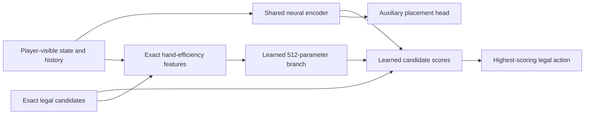

# Stage 2B candidate model card

**Status:** frozen research candidate. Teacher retention is inconclusive under the approved confirmation budget. This is not a world-class or public-play release.

| Field | Value |
|---|---|
| Recipe / seed | `features_rank01` / `202610171` |
| Checkpoint | `/Users/example/Library/Application Support/RiichiAI/stage2b/models/selected.pt` |
| SHA-256 | `5130185ba8a397b84446ba8dc2d02f068a9448db5c0373f2aeb357e4af525a6f` |
| Frozen implementation | `a28a19c559542dfe32713943eb45fc9f6e1bf312` |
| Model / features | 990,421 parameters; `actor-features-v2`; latest 128 safe events with explicit overflow |
| Added candidate features | Post-discard shanten, visible-availability ukeire, count of non-exhausted improving tile types, applicability flag |
| Base training | 800 synthetic complete matches, 490,206 decision rows; 18,500 updates of 256 sampled rows |
| Objectives | Soft teacher best-set policy targets; auxiliary terminal placement loss weighted 0.1 |
| Selection | Fixed stratified validation for checkpoints, full validation averaged over both seeds for recipes; fixed primary seed |
| Intended objective | Full-match average-rank utility `[1.5, 0.5, -0.5, -1.5]` under the pinned four-player rule profile |

## Inputs and deployment behavior

The policy receives immutable player-visible state, safe event history and the exact legal candidate list. Features use the player's own hand and publicly visible tiles. No opponent hand, future wall, teacher preference tuple or terminal-rank label is an actor input. The numeric branch adds 512 parameters and does not remove legal choices by a heuristic filter. Non-discard candidates receive zero efficiency features with the applicability flag unset.

Teacher preferences and terminal placements supervise training losses; they are not inputs in this deployment diagram. The placement head does not choose the action.

The policy chooses the highest-scoring legal semantic action, then resolves it to an allowed physical action under the versioned semantic contract. Teacher-tied choices may differ from the teacher's canonical choice. CPU/MPS numerical closeness does not promise identical choices at near ties.

Use the existing `NeuralPolicy.from_checkpoint` loader; it checks the recorded feature schema. The original v1 loader remains supported. Runtime and deployment identities refer to the entire checkpoint hash above, with separate weight identities in match records.

## Measured behavior

Full validation has 16,024 focal decisions from 100 fresh matches, balanced by teacher/student match population. Both selected feature-assisted rank-0.1 seeds achieve 100% teacher best-set discard agreement there. The matched raw controls achieve 73.14% and 64.23%.

The untouched action test has 15,727 focal decisions, including 10,712 optional discard decisions. The frozen primary model achieves **99.9826% equal-population discard agreement**. Two student-population discards worsen shanten by one; no illegal choices are recorded. Exact teacher-choice agreement is a different metric because the target allows ties.

The primary full-match development campaign contains 30 independent blocks and 240 executions with seat rotation. Candidate mean rank is **2.5083**, baseline teacher **2.5583**, a +0.05 utility difference. The pilot requires 319 fresh confirmation blocks under the predeclared formula, above the approved 256-block cap. No confirmation ran, and non-inferiority remains unestablished.

See the [measured report](../../reports/stage2b/REPORT.md) for the sustained CPU benchmark, resource use and complete comparison table. Short worker trials are not overnight reliability evidence or RL-training throughput.

## Limitations and unsuitable uses

- The teacher is a transparent local heuristic, not an expert bot. Its imitation does not establish human ladder rank or superiority to Mortal/NAGA.
- No executed chi, pon or kan appears in the collected Stage 2B corpus. The model lacks validated post-call competence even though legal call candidates are representable.
- The placement head is overconfident and has worse held-out NLL/Brier than uniform probabilities. Do not use it as a calibrated critic, GRP predictor or reward-shaping estimate.
- Both zero-placement-loss ablations collapse late in training. Their selected early checkpoints remain preserved; their failure motivates additional stability diagnostics before longer runs. The selected recipe did not show that same collapse in these two runs, which is limited evidence.
- Rule validation covers documented fixtures and conservation checks, not full independent-engine certification. Rare-rule and history-limit coverage remain incomplete.
- Results apply to the pinned synthetic populations and opponent panel. Decisions within matches are correlated, and only two training seeds were compared.

No external game corpus or pretrained weights, paid compute, public bot play or reinforcement learning was used. See the training audit, [data observations](DATA_OBSERVATIONS.md) and [next-review proposal](NEXT_REVIEW.md).
